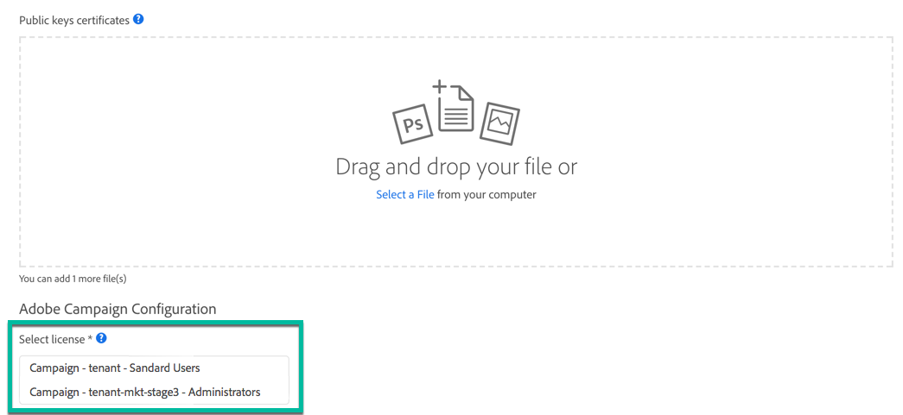

# Configuração do acesso à API {#setting-up-api-access}

O acesso à API do Adobe Campaign Standard é configurado de acordo com as etapas abaixo. Cada uma dessas etapas está detalhada na [documentação do Adobe Developer](https://developer.adobe.com/developer-console/docs/guides/#!AdobeDocs/adobeio-auth/master/AuthenticationOverview/ServiceAccountIntegration.md).

>[!IMPORTANT]
>
>Para gerenciar certificados no [Adobe Developer](https://developer.adobe.com/), verifique se você tem direitos de **Administrador do sistema** na organização ou de uma [conta de desenvolvedor](https://helpx.adobe.com/br/enterprise/using/manage-developers.html) na Admin Console.

1. **Verifique se você tem um certificado digital** ou crie um se necessário. As chaves públicas e privadas fornecidas com o certificado são necessárias nas etapas a seguir.
1. **Crie uma nova integração com o Serviço Adobe Campaign** no [Adobe Developer](https://developer.adobe.com/) e configure-a. Suas credenciais serão geradas (Chave da API, Segredo do cliente...).
1. **Crie um JSON Web Token (JWT)** a partir das credenciais geradas anteriormente e assine-o com sua chave privada. O JWT codifica todas as informações de identidade e segurança necessárias para a Adobe verificar sua identidade e conceder acesso à API.

   >[!IMPORTANT]
   >
   >O JWT (Tokens JSON da Web) está atualmente em processo de descontinuação, sendo substituído pelo OAuth. A transição está sendo realizada progressivamente nas próximas versões do Campaign. As credenciais da Conta de serviço (JWT) foram marcadas como obsoletas, elas continuarão a funcionar até 27 de janeiro de 2025. Portanto, você deve migrar seu aplicativo ou integração para usar a nova credencial OAuth de servidor para servidor antes de 27 de janeiro de 2025. A autenticação OAuth é preferível. Você encontrará todos os elementos para migrar da autenticação JWT para a autenticação OAuth nestas páginas:
   >* [Migração](https://developer.adobe.com/developer-console/docs/guides/authentication/ServerToServerAuthentication/migration/)
   >* [Implementação](https://developer.adobe.com/developer-console/docs/guides/authentication/ServerToServerAuthentication/implementation/)
   >* [Perguntas frequentes sobre JWT de descontinuação](https://developer.adobe.com/developer-console/docs/guides/authentication/ServerToServerAuthentication/faqs/)

1. **Troque seu JWT por um token de acesso** por meio de uma solicitação POST. Esse token de acesso precisará ser usado em cada cabeçalho das solicitações de API.

Para estabelecer uma sessão segura de API do Adobe I/O de serviço para serviço, cada solicitação para um serviço da Adobe deve incluir as informações abaixo no cabeçalho de Autorização.

```
-X GET https://mc.adobe.io/<ORGANIZATION>/campaign/profileAndServices/profile \
-H 'Content-Type: application/json' \
-H 'Authorization: Bearer <ACCESS_TOKEN>' \
-H 'Cache-Control: no-cache' \
-H 'X-Api-Key: <API_KEY>'
```

* **&lt;ORGANIZAÇÃO>**: esta é a sua ID de ORGANIZAÇÃO pessoal, uma ID de ORGANIZAÇÃO é fornecida pela Adobe para cada uma das suas instâncias:

  * &lt;ORGANIZATION> : sua instância de produção,
  * &lt;ORGANIZATION-mkt-stage>: sua instância de estágio.

  Para obter o valor ID da ORGANIZAÇÃO, consulte o administrador ou o contato técnico da Adobe. Você também pode recuperá-la no Adobe I/O ao criar uma nova integração, na lista de licenças (consulte a <a href="https://developer.adobe.com/developer-console/docs/guides/authentication/">documentação do Adobe Developer</a>).

* **&lt;ACCESS_TOKEN>**: seu token de acesso pessoal, que foi recuperado ao trocar seu JSON Web Token por meio de uma solicitação POST.

* **&lt;API_KEY>**: sua chave de API pessoal. Ele é fornecido no Adobe I/O após a criação de uma nova integração ao Adobe Campaign Service.

  

## Solução de problemas

Durante a integração do AdobeIO, se o seguinte erro for exibido:

```
{ 
"code": 502, 
"message": "Oops. Something went wrong. Check your URI and try again." 
}
```


Consulte o administrador ou o contato técnico da Adobe para verificar se o parâmetro CNAME foi criado corretamente.
