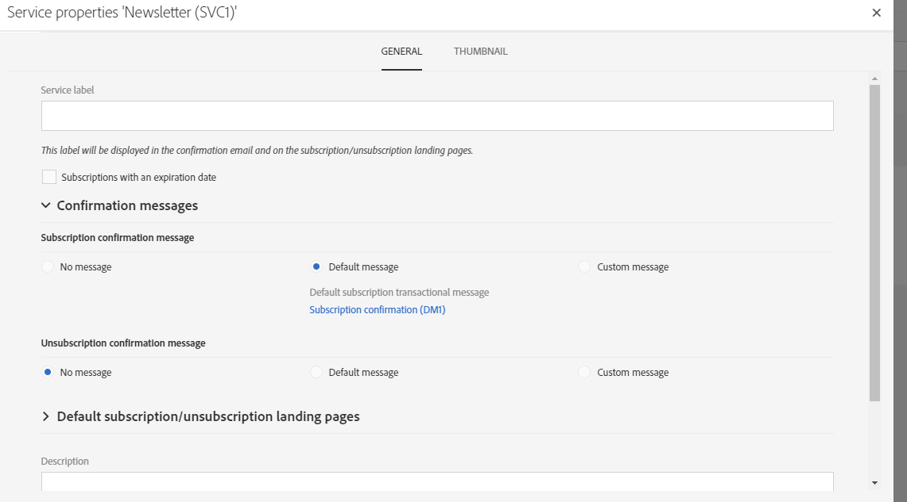
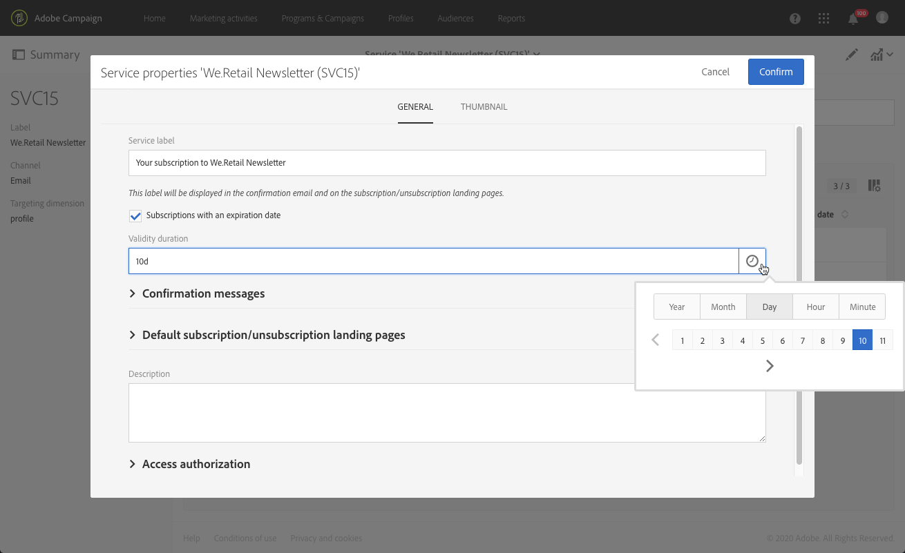

# Criação de um serviço{#creating-a-service}

Para gerenciar assinaturas, primeiro crie e configure um serviço. A configuração de um novo serviço permite especificar as confirmações por email que os perfis receberão quando assinarem ou cancelarem a assinatura do serviço. Você também definirá as páginas de destino de assinatura e unsubscription vinculadas ao serviço. Por exemplo, um link de assinatura de serviço inserido em um email direcionará o perfil automaticamente para a página de destino de assinatura especificada no serviço.

 [Conheça este recurso no vídeo](#video)

Para configurar um serviço:

1. No menu avançado **[!UICONTROL Profiles & audiences]** > **[!UICONTROL Services]** no logotipo do Adobe Campaign, adicione um novo serviço ou selecione um serviço existente. Se você criar um novo serviço, siga as etapas mostradas na tela.

   Um modelo de serviço padrão está disponível. Ele é pré-configurado com páginas de destino padrão e emails de confirmação. Você pode criar outros modelos para definir configurações específicas. Para saber mais, consulte a seção [Gerenciamento de modelos](../../start/using/marketing-activity-templates.md).

1. Na seção **[!UICONTROL Service properties]**, acessada pelo botão  no painel de serviço, configure as mensagens de confirmação para assinaturas e unsubscriptions.

   

1. Selecione a opção **[!UICONTROL Subscriptions with an expiration date]** para definir uma duração de validade para a assinatura.

   

   Você pode usar a data de expiração em uma atividade Segmentação para direcionar os perfis que assinaram um serviço que não expirou.

1. Preencha o campo **[!UICONTROL Service label]**. O rótulo do serviço é obrigatório para usar uma mensagem de confirmação personalizada.

1. Selecione um modelo de mensagem de confirmação para assinaturas e unsubscriptions. Três modos estão disponíveis:

   * **[!UICONTROL No message]**: este modo permite criar um serviço sem uma mensagem de confirmação.
   * **[!UICONTROL Default message]**: este modo usará a mensagem transacional de confirmação de assinatura ou unsubscription. As mensagens de confirmação padrão são genéricas e serão as mesmas para todos os serviços que usam o modo padrão.

     >[!NOTE]
     >
     >Você pode modificar uma mensagem padrão clicando no rótulo na seção **[!UICONTROL Service properties]** ou selecionando-a na lista de mensagens transacionais do Adobe Campaign depois de marcar a caixa **[!UICONTROL Show internal transactional messages]**.

   * **[!UICONTROL Custom message]**: este modo permite processar as mensagens de confirmação personalizadas, específicas de cada serviço. Em seguida, selecione a opção **[!UICONTROL Custom subscription event configuration]** que está associada a um modelo de [mensagem transacional](../../channels/using/getting-started-with-transactional-msg.md) específico. Para saber mais, consulte [Confirmação da assinatura em um serviço](../../audiences/using/confirming-subscription-to-a-service.md).

1. Salve o serviço. Agora ele está pronto para ser usado.

Depois que um serviço é criado, você poderá promovê-lo.

**Tópicos relacionados:**

* [Promoção de um serviço](../../audiences/using/promoting-a-service.md)
* [Criação de um público-alvo com assinantes](../../audiences/using/creating-audiences.md#creating-list-audiences)
* [Vinculação de uma landing page a um serviço](../../channels/using/configuring-landing-page.md#linking-a-landing-page-to-a-service)

## Tutorial em vídeo {#video}

Este vídeo mostra como criar um serviço e gerenciar suas assinaturas.

>[!VIDEO](https://video.tv.adobe.com/v/24673?quality=12)

Vídeos extras explicativos do Campaign Standard estão disponíveis [aqui](https://experienceleague.adobe.com/docs/campaign-standard-learn/tutorials/overview.html?lang=pt-BR).
