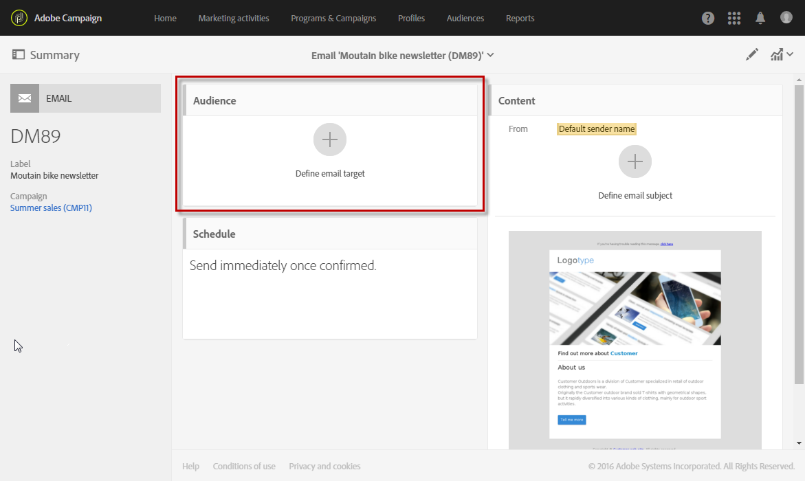
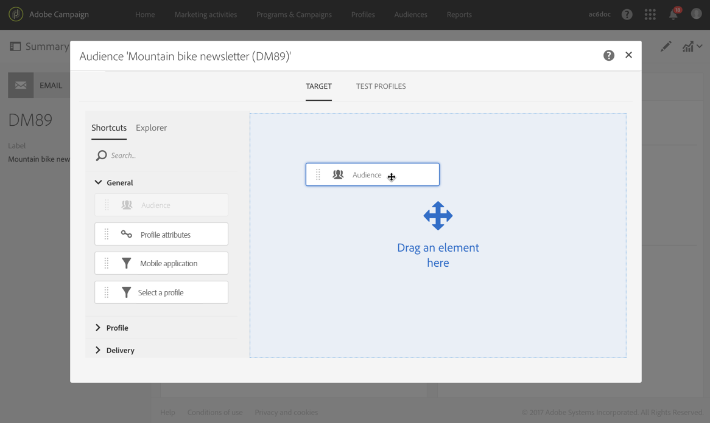
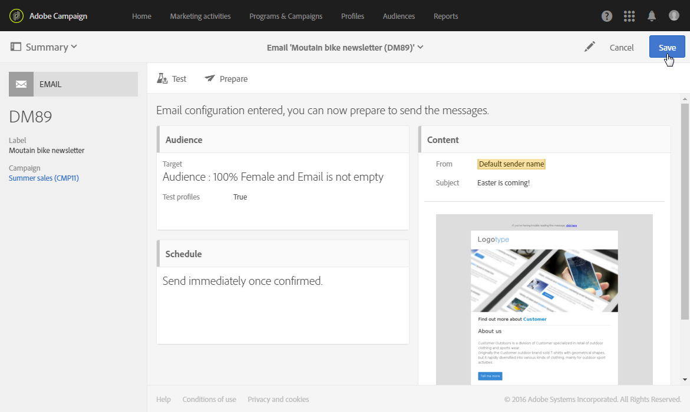

# Seleção de um público-alvo em uma mensagem{#selecting-an-audience-in-a-message}

O Adobe Campaign permite configurar vários tipos de perfil no público-alvo de uma mensagem.

Os públicos-alvo podem ser definidos ao criar a mensagem com o assistente de criação ou no painel de mensagens se a mensagem já tiver sido criada.

>[!NOTE]
>
>Se o público-alvo tiver sido criado em um fluxo de trabalho e enriquecido com dados adicionais, você não poderá usar esses dados para personalizar uma entrega independente. Eles só poderão ser usados de uma entrega executado em um fluxo de trabalho.

1. No painel, acesse o bloco de públicos-alvo para iniciar.

   

   A tela para definir os públicos-alvo é aberta. Ela tem duas guias que permitem definir separadamente cada tipo de público-alvo que receberá a mensagem:

   * Target
   * Perfis de teste

   

1. Defina o **[!UICONTROL Target]** principal do email. Ele é o público-alvo normal do email.

   O destino é definido na guia **[!UICONTROL Target]** e é composto de perfis identificados do banco de dados. Você pode estabelecer seu público-alvo principal usando as funcionalidades do [Editor de consultas](../../automating/using/editing-queries.md#creating-queries).

   Nessa guia, a paleta **[!UICONTROL Shortcuts]** contém apenas os filtros predefinidos e os públicos-alvo que foram definidas nos perfis identificados. A guia **[!UICONTROL Explorer]** permite acessar configurações adicionais.

   Portanto, é possível reutilizar e combinar os públicos-alvo, aplicar filtros adicionais a eles etc.

   >[!NOTE]
   >
   >Ao direcionar um público-alvo, observe que a definição do público-alvo não é referenciada, mas **copiada** para a consulta. Se você fizer qualquer alteração no público depois de ele ter sido direcionado em um query, configure o query novamente para levar a nova definição em consideração.

1. Defina os **[!UICONTROL Test profiles]** que deseja usar para o email. Os perfis de teste receberão as provas que você enviar para testar o email antes que ele seja enviado ao público-alvo principal.

   Para saber mais sobre como configurar perfis de teste, consulte a seção [Perfis de teste](../../audiences/using/managing-test-profiles.md).

1. Se necessário, você pode definir um grupo de controle usando a guia correspondente. Isso permitirá que você retire alguns perfis do seu público-alvo para que eles não recebam a mensagem. Para obter mais informações, consulte [Adicionando um grupo de controle](../../sending/using/control-group.md).

1. Você também pode usar endereços de substituição para obter uma representação exata da mensagem que o perfil receberá.  Para mais informações, consulte [Testar mensagens de email usando perfis segmentados](../../sending/using/testing-messages-using-target.md).

O bloco de públicos-alvo é atualizado e mostra que um público-alvo e perfis de teste foram selecionados para o email específico.

