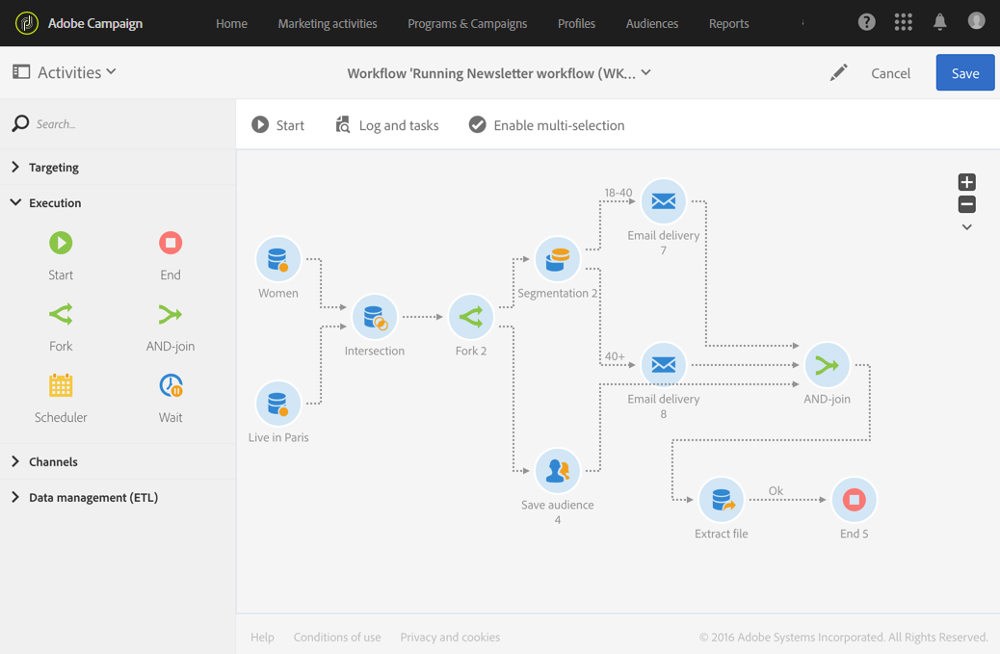

# AND-join{#and-join}

## Descrição {#description}

A atividade **[!UICONTROL AND-join]** permite sincronizar várias ramificações de execução de um fluxo de trabalho.

## Contexto de uso {#context-of-use}

A atividade **[!UICONTROL AND-join]** só acionará a transição de saída depois que todas as transições de entrada estiverem ativadas, ou seja, depois que todas as atividades anteriores estiverem concluídas.

## Configuração {#configuration}

1. Solte várias atividades, como consultas, no fluxo de trabalho para formar pelo menos duas ramificações de execução diferentes.
1. Arraste e solte uma atividade **[!UICONTROL AND-join]** no seu fluxo de trabalho.
1. Conecte-a depois das duas ramificações diferentes que você quer sincronizar.
1. Selecione e abra a atividade usando o botão  das ações rápidas exibidas.
1. Selecione o conjunto principal a ser mantido na transição de saída. Se você não selecionar nenhum conjunto, uma população aleatória será enviada da atividade.
1. Confirme a configuração da sua atividade e salve o fluxo de trabalho.

## Exemplo {#example}

O exemplo a seguir mostra duas ramificações de fluxo de trabalho antes de elas serem unidas à atividade **[!UICONTROL AND-join]**. A extração de arquivos só poderá ocorrer quando as três transições de entrada da atividade **[!UICONTROL AND-join]** estiverem habilitadas.

