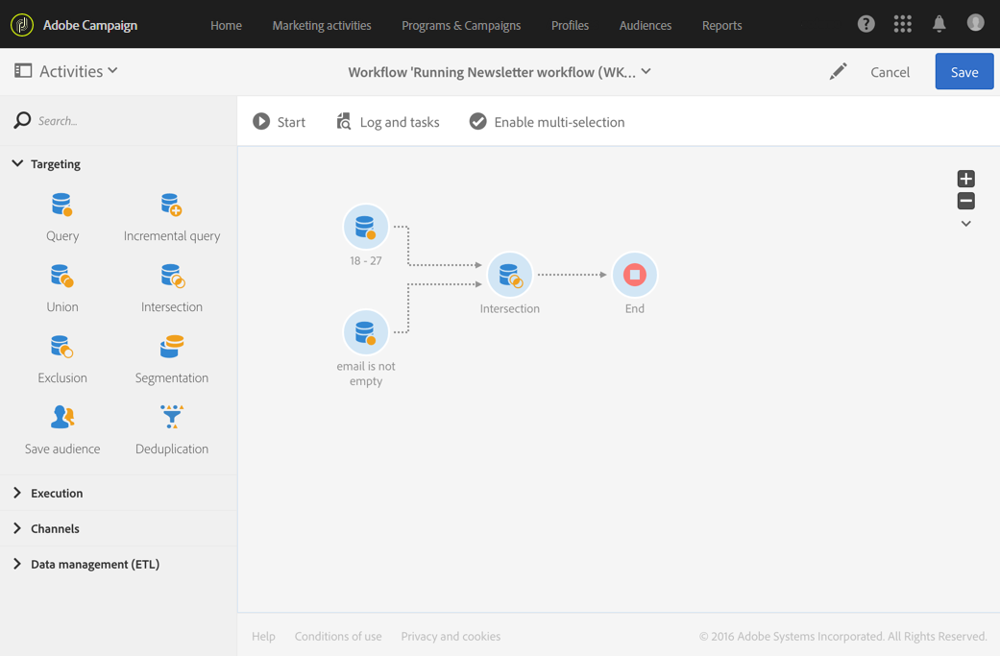

# Interseção{#intersection}

## Descrição {#description}

A atividade **[!UICONTROL Intersection]** permite manter somente os elementos comuns aos diferentes populações de entrada na atividade.

## Contexto de uso {#context-of-use}

A atividade **[!UICONTROL Intersection]** é geralmente usada para fazer filtragem adicional em populações provenientes de transições de entrada.

## Configuração {#configuration}

1. Arraste e solte uma atividade **[!UICONTROL Intersection]** no seu fluxo de trabalho.
1. Conecte-a às outras atividades anteriores a ela, como consultas.
1. Selecione e abra a atividade usando o botão  das ações rápidas exibidas.
1. Selecione o **[!UICONTROL Reconciliation type]**:

   * **[!UICONTROL Keys only]**: Modo padrão. A atividade só mantém um elemento quando elementos de transições de entrada diferentes têm a mesma chave.
   * **[!UICONTROL All shared columns]**: Os dados são reconciliados com base em colunas em comum com as transições de entrada. Portanto, é necessário selecionar o conjunto principal que servirá de base para comparação. Essa opção só poderá ser usada se as dimensões de direcionamento da população de entrada forem diferentes.
   * **[!UICONTROL A selection of columns]**: selecione esta opção para definir a lista de colunas em que a reconciliação de dados será aplicada. Primeiro, selecione o conjunto principal (aquele que contém os dados de origem), e especifique os campos a serem usados para a junção.

1. Marque a caixa **[!UICONTROL Use common additional data only]** se quiser manter somente os dados adicionais existentes em todas as transições de entrada.
1. Se necessário, gerencie as [Transições](../../automating/using/activity-properties.md) de atividade para acessar as opções avançadas para a população de saída.
1. Confirme a configuração da sua atividade e salve o fluxo de trabalho.

## Exemplo {#example}

O exemplo a seguir mostra a intersecção entre duas atividades de consulta. Ela está sendo usada aqui para examinar o banco de dados do Adobe Campaign e recuperar perfis com idade entre 18 e 27 anos e perfis cujo endereço de email foi fornecido, respectivamente.

