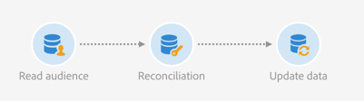

# Reconciliar um público-alvo do tipo Arquivo com o banco de dados {#example--reconcile-a-file-audience-with-the-database}

Este exemplo mostra como usar a atividade **[!UICONTROL Read audience]** para reconciliar um público-alvo criado diretamente de uma importação de arquivo.

Em uma importação de arquivo, você pode salvar o conteúdo diretamente em um público-alvo. Esse público-alvo é do tipo File e os dados não estão vinculados a nenhum recurso do banco de dados.

O fluxo de trabalho de importação foi criado da seguinte forma:


* Uma atividade [Load file](../../automating/using/load-file.md) faz upload de um arquivo contendo dados de perfis que foram extraídos de uma ferramenta externa.

  Por exemplo:

  ```
  lastname;firstname;birthdate;email;crmID
  Smith;Hayden;23/05/1989;hayden.smith@example.com;124365
  Mars;Daniel;17/11/1987;dannymars@example.com;123545
  Smith;Clara;08/02/1989;hayden.smith@example.com;124567
  Durance;Allison;15/12/1978;allison.durance@example.com;120987
  Lucassen;Jody;28/03/1988;jody.lucassen@example.com;127634
  Binder;Tom;19/01/1982;tombinder@example.com;128653
  Binder;Tommy;19/01/1915;tombinder@example.com;134576
  Connor;Jade;10/10/1979;connor.jade@example.com;132452
  Mack;Clarke;02/03/1985;clarke.mack@example.com;149876
  Ross;Timothy;04/07/1986;timross@example.com;157643
  ```

* Uma atividade [Save audience](../../automating/using/save-audience.md) salva os dados recebidos como um público-alvo. Como os dados ainda não foram reconciliados, o público-alvo é do tipo File, e os dados ainda não são reconhecidos como de perfil.

O fluxo de trabalho de reconciliação foi criado da seguinte forma:



* Uma atividade [Read audience](../../automating/using/read-audience.md) faz upload do público-alvo File criado no fluxo de trabalho de importação. Os dados do público-alvo ainda não foram reconciliados com o banco de dados do Adobe Campaign.
* Uma atividade [Reconciliation](../../automating/using/reconciliation.md) identifica os dados recebidos como perfis por meio da guia **[!UICONTROL Identification]**. Por exemplo, usando o campo **email** como critério de reconciliação.
* Uma atividade [Update data](../../automating/using/update-data.md) insere e atualiza o recurso de perfis do banco de dados com os dados recebidos. Como os dados já estão identificados como perfis, você pode selecionar a opção **[!UICONTROL Directly using the targeting dimension]** e selecionar **[!UICONTROL Profiles]** na guia **[!UICONTROL Identification]** da atividade. Em seguida, adicione a lista de campos que precisam ser atualizados na guia correspondente.
