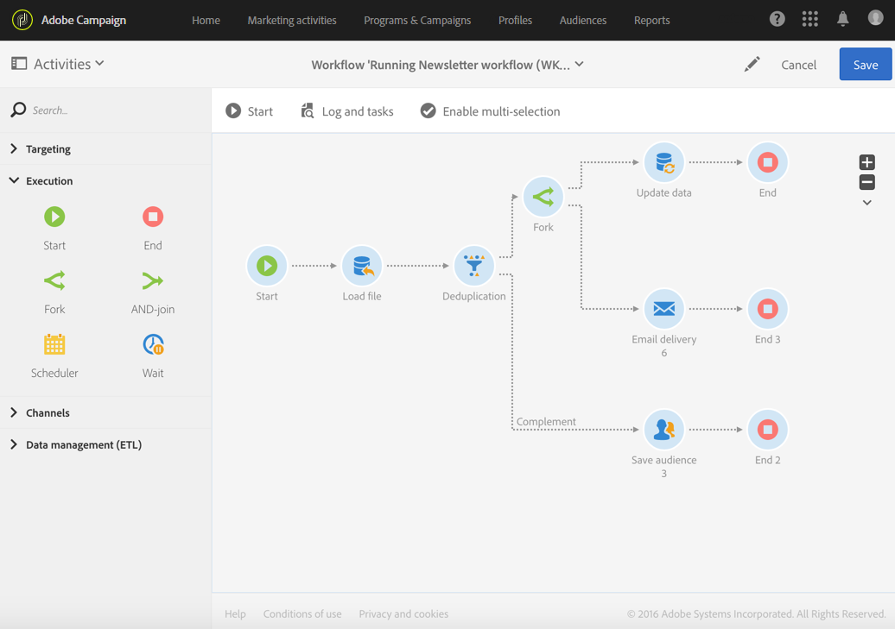

# Início e término{#start-and-end}

## Descrição {#description}

As atividades **[!UICONTROL Start]** e **[!UICONTROL End]** permitem que você marque claramente o início e o término do fluxo de trabalho.

## Contexto de uso {#context-of-use}

A execução de um fluxo de trabalho inicia com atividades sem transição de entrada e é interrompida quando não há mais tarefas em andamento. No entanto, você pode adicionar as atividades **[!UICONTROL Start]** e **[!UICONTROL End]** para marcar claramente os pontos de início e término de um fluxo de trabalho. Isso é útil principalmente para fluxos de trabalho relativamente complexos.

Como prática recomendada, use uma atividade **[!UICONTROL End]** em vez de deixar que a última transição de um fluxo de trabalho ocorra automaticamente para garantir que o fluxo de trabalho termine sem erros.

## Configuração {#configuration}

1. Arraste e solte uma atividade **[!UICONTROL Start]** ou **[!UICONTROL End]** no fluxo de trabalho.
1. Coloque a atividade **[!UICONTROL Start]** na frente de outras atividades, como consultas, e a atividade **[!UICONTROL End]** após uma série de atividades.
1. Selecione e abra a atividade usando o botão  das ações rápidas exibidas.
1. Você pode configurar o objeto **End** para que ele interrompa todas as tarefas em andamento do fluxo de trabalho, inclusive as que ainda não foram concluídas. Para isso, selecione a opção correspondente.
1. Confirme a configuração da sua atividade e salve o fluxo de trabalho.

## Acionamento de outro fluxo de trabalho {#triggering-another-workflow}

Na guia **[!UICONTROL External signal]** de uma atividade **[!UICONTROL End]**, é possível acionar outro fluxo de trabalho. Consulte a seção [Sinal externo](../../automating/using/external-signal.md).

## Exemplo {#example}

O exemplo a seguir mostra como um fluxo de trabalho complexo é executado com uma atividade **[!UICONTROL Start]** e várias atividades **[!UICONTROL End]**. A caixa **[!UICONTROL Stop all tasks in progress]** foi marcada para a primeira atividade **[!UICONTROL End]**. Quando a tarefa correspondente for concluída, todo o fluxo de trabalho será interrompido: isso terá o mesmo efeito do botão  (consulte a seção [Barra de ação](../../automating/using/workflow-interface.md#action-bar)).

