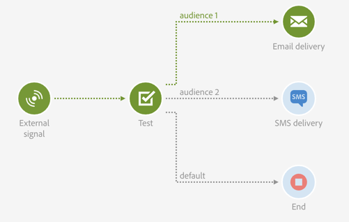
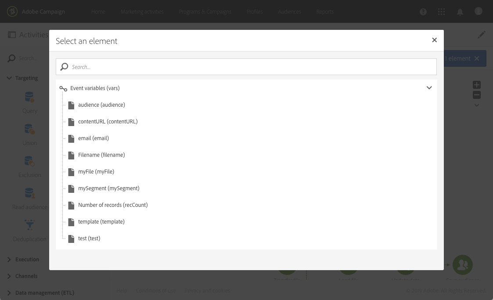
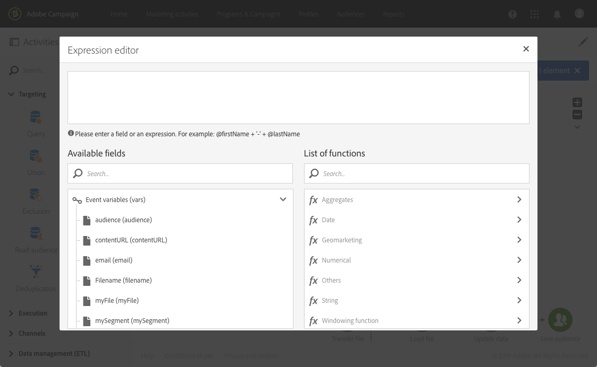

# Teste{#test}

## Descrição {#description}

A atividade **[!UICONTROL Test]** permite uma transição com base em um resultado de teste.

## Contexto de uso {#context-of-use}

Uma atividade **Test** ativa a primeira transição que satisfaz a condição associada a ela.

Se nenhuma condição for satisfeita e a opção **Use default transition** estiver ativada, a transição padrão será ativada.

As condições podem ser baseadas em **funções** ou **variáveis**, por exemplo, as variáveis de eventos que foram declaradas na atividade **[!UICONTROL External signal]** do fluxo de trabalho.

**Tópicos relacionados:**

* [Lista de funções](../../automating/using/list-of-functions.md)
* [Chamar um fluxo de trabalho com parâmetros externos](../../automating/using/calling-a-workflow-with-external-parameters.md)

## Configuração {#configuration}

1. Arraste e solte uma atividade **[!UICONTROL Test]** no fluxo de trabalho.
1. Selecione e abra a atividade usando o botão  das ações rápidas exibidas.
1. Defina os atributos de cada condição:

   Ao editar o campo **[!UICONTROL Condition]**, dois botões ajudam a chamar as variáveis de eventos e editar expressões que combinam variáveis e funções:

   * : selecione a variável de eventos entre todas as variáveis disponíveis no fluxo de trabalho (consulte [esta página](../../automating/using/customizing-workflow-external-parameters.md)).

     Por exemplo, você pode verificar o número de arquivos baixados após uma atividade [Transferência de arquivos](../../automating/using/transfer-file.md) usando a variável **[!UICONTROL filesCount]**.

     

   * : edite as expressões que combinam variáveis e funções. Para saber mais sobre o editor de expressão, consulte [esta seção](../../automating/using/advanced-expression-editing.md).

     
