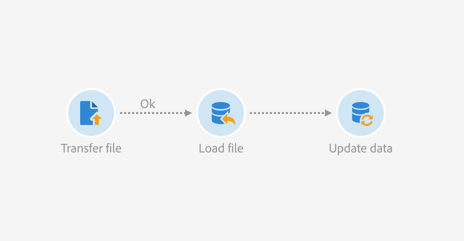
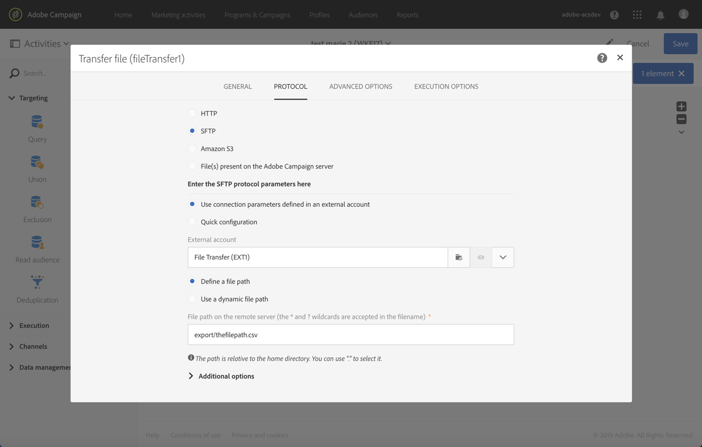
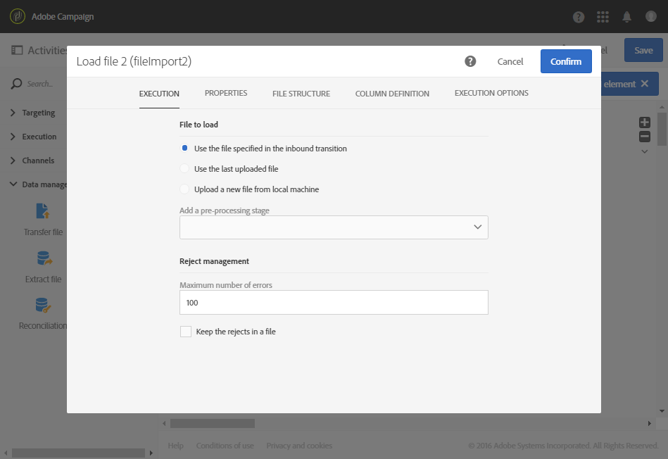

# Atualização de dados com base em um download automático de arquivo {#updating-data-automatic-file-download}

A atividade de carregamento de arquivo estrutura principalmente os dados de uma atividade de transferência de arquivo para integrá-los aos dados existentes.

O exemplo a seguir mostra o resultado de uma atividade de carregamento de arquivo baixada automaticamente por meio de uma atividade de transferência de arquivo, seguida por uma atividade de atualização de dados. Esse fluxo de trabalho tem como objetivo enriquecer o banco de dados do Adobe Campaign com novos perfis ou atualizar os perfis existentes usando os dados recuperados do arquivo importado.

Para criar o workflow, siga estas etapas:

1. Arraste e solte uma atividade [Transfer file](../../automating/using/transfer-file.md) no seu fluxo de trabalho.
1. Selecione e abra a atividade usando o botão  das ações rápidas exibidas.
1. Configure a atividade de forma que ela recupere o arquivo desejado. Na guia **[!UICONTROL Protocol]**, selecione **SFTP**.
1. Selecione a opção **Use parâmetros de conexão definidos em uma conta externa**.
1. Insira o nome da conta externa.
1. Insira o **Caminho do arquivo no servidor remoto**.

   

1. Confirme sua atividade.
1. Arraste e solte uma atividade [Carregar arquivo](../../automating/using/load-file.md) no fluxo de trabalho e coloque-a depois da atividade **[!UICONTROL Transfer file]**.
1. Selecione e abra a atividade usando o botão  das ações rápidas exibidas.
1. Na seção **[!UICONTROL File to load]** da guia **[!UICONTROL Execution]**, marque a opção **[!UICONTROL Use the file specified in the inbound transition]**.

   

1. Configure a atividade conforme especificado anteriormente.
1. Arraste e solte uma atividade [Atualizar dados](../../automating/using/update-data.md) no seu fluxo de trabalho, coloque-a depois da atividade **[!UICONTROL Load file]** e configure-a.

Depois que o fluxo de trabalho é iniciado, os dados do arquivo carregado são extraídos e depois usados para enriquecer o banco de dados do Adobe Campaign.
