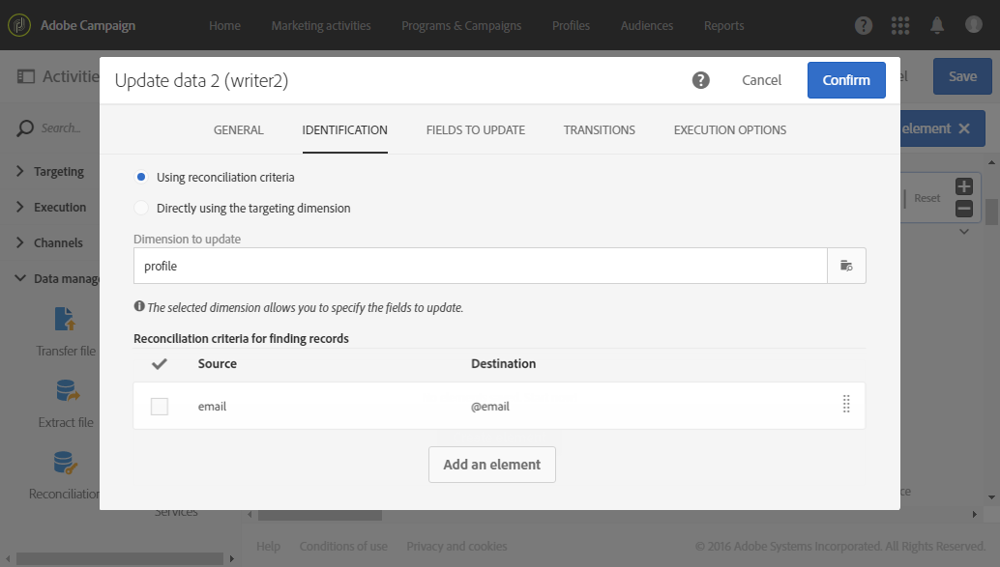
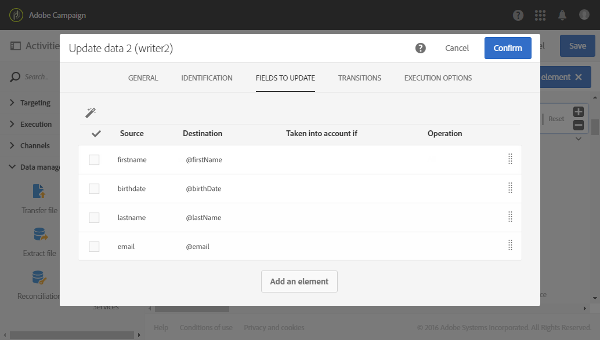

# Atualização do banco de dados com dados externos {#update-database-file}

O exemplo a seguir mostra a configuração de uma atividade **[!UICONTROL Update data]** após uma atividade **[!UICONTROL Load file]**. O objetivo desse fluxo de trabalho é adicionar ou atualizar perfis ao banco de dados do Adobe Campaign com os dados recuperados do arquivo.

Neste exemplo, a chave de reconciliação usada é o **endereço de email**. O arquivo carregado na atividade [Carregar arquivo](../../automating/using/load-file.md) é um arquivo de formato **.txt** que contém os seguintes dados de exemplo:

```
lastname;firstname;email;birthdate
jackman;megan;megan.jackman@testmail.com;07/08/1975
phillips;edward;phillips@testmail.com;09/03/1986
weaver;justin;justin_w@testmail.com;11/15/1990
martin;babeth;babeth_martin@testmail.net;11/25/1964
reese;richard;rreese@testmail.com;02/08/1987
cage;nathalie;cage.nathalie227@testmail.com;07/03/1989
xiuxiu;andrea;andrea.xiuxiu@testmail.com;09/12/1992
grimes;daryl;daryl_890@testmail.com;12/06/1979
tycoon;tyreese;tyreese_t@testmail.net;10/08/1971
```

A atividade [Atualizar dados](../../automating/using/update-data.md) está configurada da seguinte maneira:




