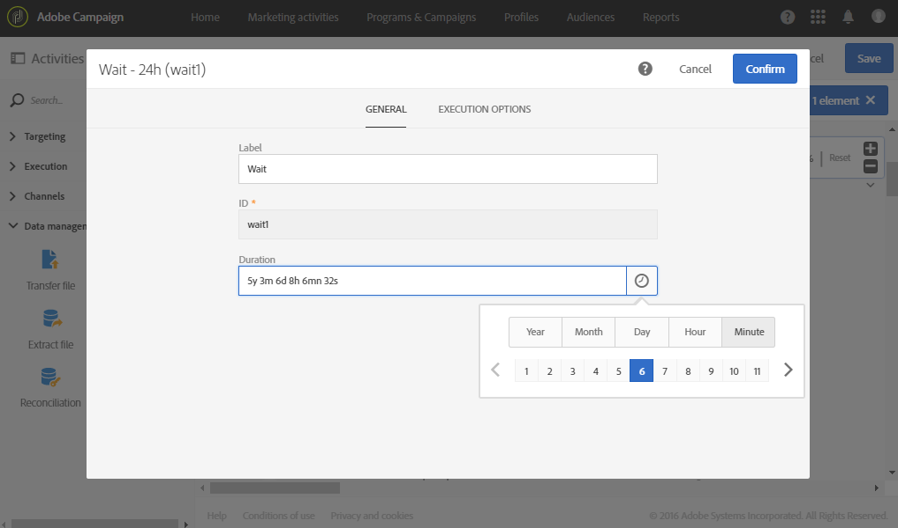
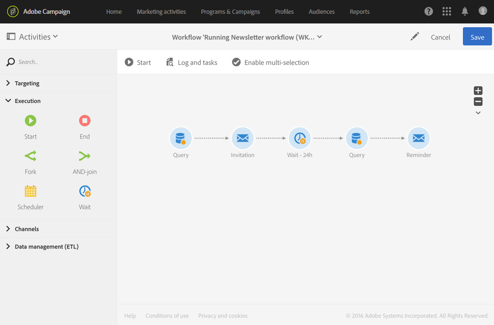

# Aguardar{#wait}

## Descrição {#description}

A atividade **[!UICONTROL Wait]** suspende temporariamente a execução de uma parte do fluxo de trabalho. Ela ativa a transição de saída após um atraso que pode variar de alguns segundos a vários meses, o que executa as atividades colocadas depois.

## Contexto de uso {#context-of-use}

A atividade **[!UICONTROL Wait]** é usada para permitir que um determinado período transcorra entre duas atividades que estão sendo executadas. Por exemplo, a espera de vários dias após uma atividade de entrega de email para depois analisar as aberturas e os cliques gerados durante esse período antes de executar qualquer operação de acompanhamento (email de lembrete, criação de público-alvo, etc.).

## Configuração {#configuration}

1. Arraste e solte uma atividade **[!UICONTROL Wait]** no seu fluxo de trabalho.
1. Selecione e abra a atividade usando o botão  das ações rápidas exibidas.
1. Especifique a **[!UICONTROL Duration]** da espera entre a ativação das transições de entrada e saída da atividade.

   Você pode inserir manualmente a duração ou usar o seletor disponível no campo.

   

1. Confirme a configuração da sua atividade e salve o fluxo de trabalho.

## Exemplo {#example}

O exemplo a seguir ilustra a atividade **[!UICONTROL Wait]** em um caso de uso comum. Um convite é enviado por email para um evento. 24 horas após o envio, os logs de entrega do email são analisados e um email de lembrete é enviado para as pessoas que receberam o primeiro email, mas não se inscreveram.

O fluxo de trabalho é apresentado da seguinte forma:

* Um primeiro **[!UICONTROL Query]** é direcionado aos perfis que receberão o convite por email.
* Um **[!UICONTROL Email delivery]** envia o convite pela primeira vez para os perfis selecionados.
* Uma atividade **[!UICONTROL Wait]** de 24 horas faz uma pausa entre o momento em que o convite foi enviado e o restante do fluxo de trabalho.
* Um segundo **[!UICONTROL Query]** é direcionado aos perfis que receberam o primeiro email, mas não clicaram no link de assinatura.
* Um segundo **[!UICONTROL Email delivery]** envia um lembrete do convite para as pessoas selecionadas.
