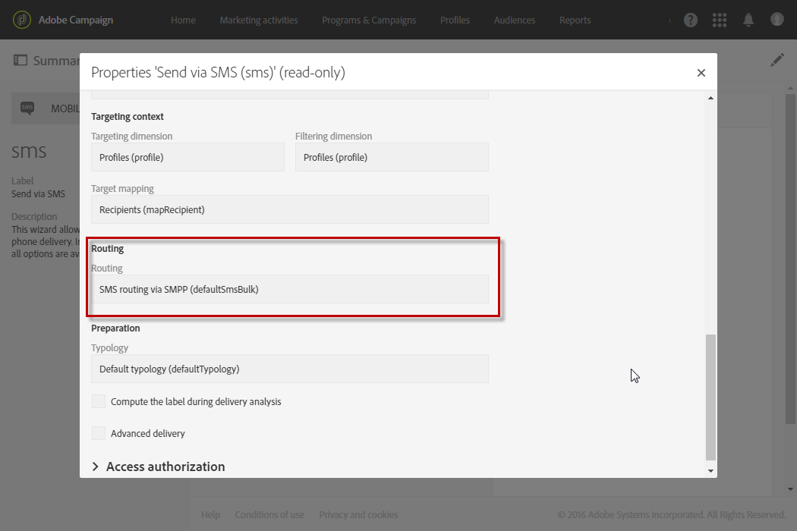

# Sobre mensagens SMS{#about-sms-messages}

O Adobe Campaign permite que você entregue mensagens SMS (Short Message Service).

>[!NOTE]
>
>O canal SMS é um complemento. Verifique o contrato de licença.

Para mensagens SMS, você poderá criar, modificar e personalizar mensagens somente no formato de texto. Você também poderá visualizar suas mensagens SMS antes de enviá-las.

O comprimento de uma mensagem SMS é restrito a 160 caracteres se estiver na codificação GSM e somente 70 caracteres se estiver em Unicode. No entanto, alguns caracteres especiais podem influenciar o comprimento da mensagem. Para obter mais informações, consulte a seção [codificação de SMS](../../administration/using/configuring-sms-channel.md#sms-encoding--length-and-transliteration).

As mensagens SMS podem ser criadas no menu **[!UICONTROL Marketing activities]**, em uma campanha ou em um fluxo de trabalho. Consulte [Criação de uma mensagem SMS](../../channels/using/creating-an-sms-message.md).

Para enviar mensagens SMS para um telefone celular, você precisa:

* Uma conta externa de **[!UICONTROL Routing]** configurada no canal **[!UICONTROL Mobile (SMS)]** com o modo **[!UICONTROL Bulk delivery]**. Para mais informações, consulte a seção [Roteamento](../../administration/using/configuring-sms-channel.md#defining-an-sms-routing).
* Um modelo da entrega vinculado corretamente a essa conta externa.

**Tópicos relacionados:**

* [Gerenciamento de modelos](../../start/using/marketing-activity-templates.md)
* [Configuração de SMS](../../administration/using/configuring-sms-channel.md#defining-an-sms-routing)
* [Relatório de SMS](../../reporting/using/sms-report.md)
* [Guia do Campaign Standard Mobile](../../channels/using/get-started-communication-channels.md)

## Modelo de entrega de SMS {#sms-delivery-template}

O Adobe Campaign oferece um template de delivery para dispositivos móveis. Este modelo deve estar corretamente vinculado à conta externa usada para o canal **[!UICONTROL Mobile (SMS)]**. Para acessá-lo e modificá-lo:

1. Selecione **[!UICONTROL Resources]** > **[!UICONTROL Templates]** > **[!UICONTROL Delivery templates]** no menu avançado.
1. Passe o mouse sobre o modelo **[!UICONTROL Send via SMS]** e selecione a opção **Duplicar elemento**.
1. Selecione o novo modelo.
1. Clique no botão **[!UICONTROL Edit properties]**.
1. Na seção **[!UICONTROL Advanced parameters]** das propriedades do modelo, verifique se o modelo está vinculado à conta externa a ser usada para entrega de SMS.

   

**Tópicos relacionados:**

* [Gerenciamento de modelos](../../start/using/marketing-activity-templates.md)
