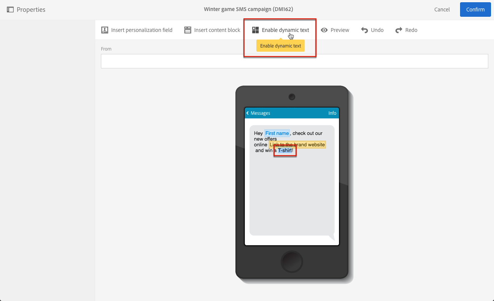
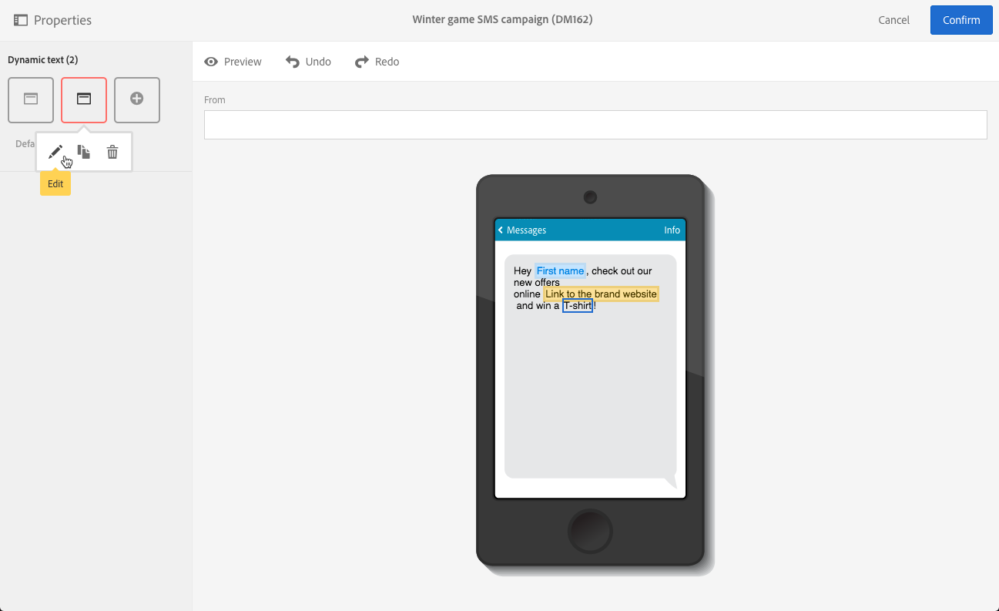
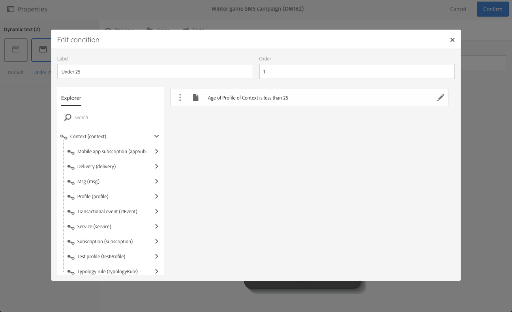
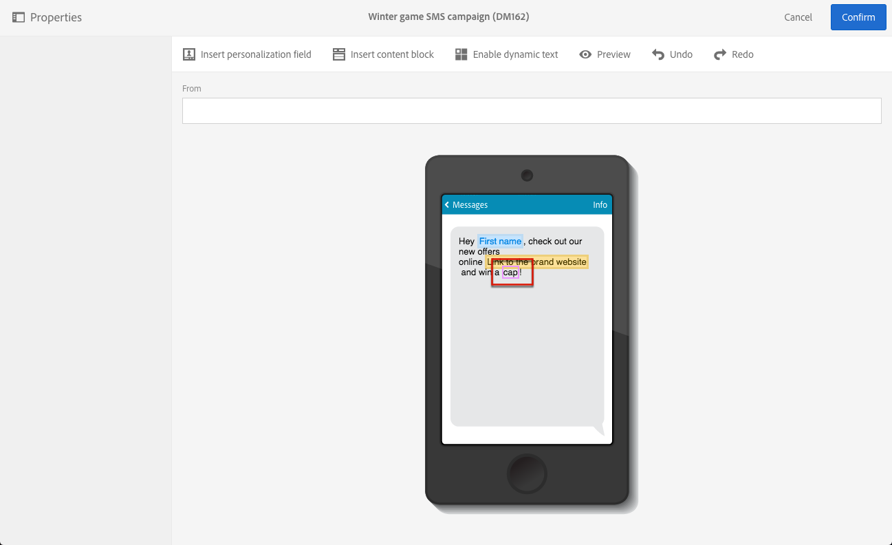

# Definição de texto dinâmico{#defining-dynamic-text}

O texto dinâmico é definido da mesma forma que o conteúdo dinâmico. Consulte a seção [Definição de conteúdo dinâmico](../../designing/using/personalization.md#defining-dynamic-content-in-an-email).

>[!NOTE]
>
>Para SMS e push, você só pode definir texto dinâmico. Você pode definir conteúdo dinâmico e texto em uma página de aterrissagem. Se você quiser definir texto dinâmico com o [Designer de email](../../designing/using/designing-content-in-adobe-campaign.md), consulte [Definindo conteúdo dinâmico em um email](../../designing/using/personalization.md#defining-dynamic-content-in-an-email).

Observe que pares substitutos, caracteres não incluídos no Plano Multilíngue Básico do conjunto de caracteres Unicode, não podem ser armazenados em 2 bytes (16 bits) e precisam ser codificados em 2 caracteres UTF-16. Esses personagens incluem alguns ideógrafos CJK, a maioria emojis e algumas línguas.
 Esses caracteres podem causar alguns problemas de incompatibilidade no texto dinâmico. Você precisa executar testes de segurança antes de enviar as mensagens.

O exemplo abaixo mostra como definir texto dinâmico em uma mensagem SMS.

1. Selecione o texto no corpo da mensagem ou landing page.
1. Clique em **[!UICONTROL Enable dynamic text]**.

   

   A opção **[!UICONTROL Dynamic text]** é exibida na paleta. Ela é configurada da mesma forma que o conteúdo dinâmico.

1. Selecione uma variante.

   

1. Defina uma condição para essa variante.

   

Depois que uma condição é definida para pelo menos uma variante, um quadro roxo é exibido ao redor do texto dinâmico.

