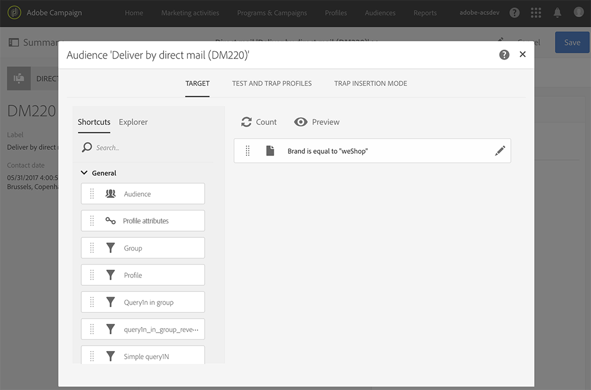
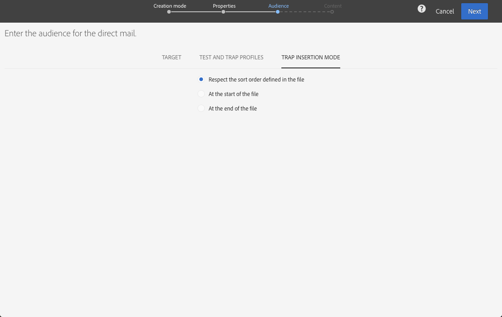

# Definição de público-alvo de correspondência direta{#defining-the-direct-mail-audience}

Você pode definir o público-alvo no assistente de criação ou clicando na seção **Audience** do painel da entrega.

## Definição do público-alvo principal {#defining-the-main-target}

Para correspondência direta, os perfis segmentados são aqueles que serão incluídos no arquivo de extração que deve ser enviado ao seu provedor de correspondência direta.

Para cada perfil segmentado, uma nova linha é adicionada ao arquivo de extração. A quantidade de informações de perfil que será incluída para cada destinatário é definida na tela [Definição da extração](../../channels/using/defining-the-direct-mail-content.md#defining-the-extraction).

>[!IMPORTANT]
>
>Verifique se os perfis incluem o CEP, pois essa informação é essencial para o provedor de correspondência direta. Verifique também se você marcou a caixa **[!UICONTROL Address specified]** nas informações dos perfis. Consulte [Recomendações](../../channels/using/about-direct-mail.md#recommendations).

## Adicionar perfis de teste e cobertura {#adding-test-and-trap-profiles}

Adicione perfis de teste para testar seu arquivo com um pequeno número de perfis. Assim, você pode criar rapidamente uma amostra de arquivo para testar e validar a estrutura antes de preparar o arquivo real. Consulte [Gerenciamento de perfis de teste](../../audiences/using/managing-test-profiles.md).

O uso de coberturas é essencial para entregas de correspondência direta. Elas permitem verificar se o provedor de correspondência direta está realmente enviando a comunicação e se ele não está enviando sua lista de clientes a outro provedor. Consulte [Uso de coberturas](../../sending/using/using-traps.md).

Para entregas de correspondência direta, as coberturas são adicionadas durante a extração e combinadas no documento de saída. Por padrão, elas são inseridas na ordem de classificação do arquivo de saída, mas é possível optar por inseri-las no final ou no início do arquivo. Ao definir o público-alvo, selecione a opção desejada na guia **[!UICONTROL Trap insertion mode]**.

