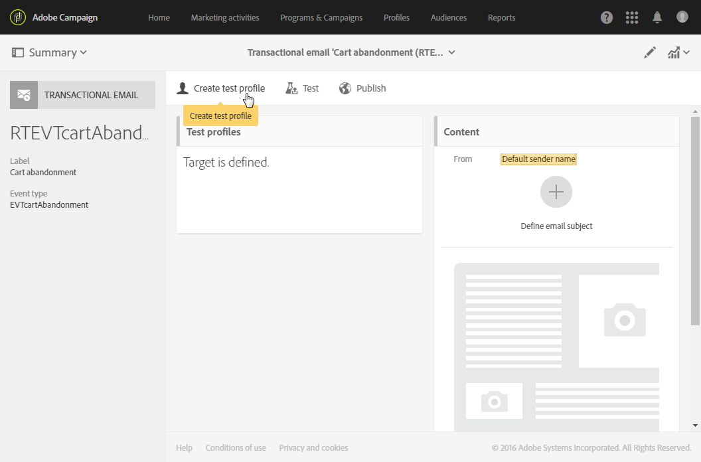
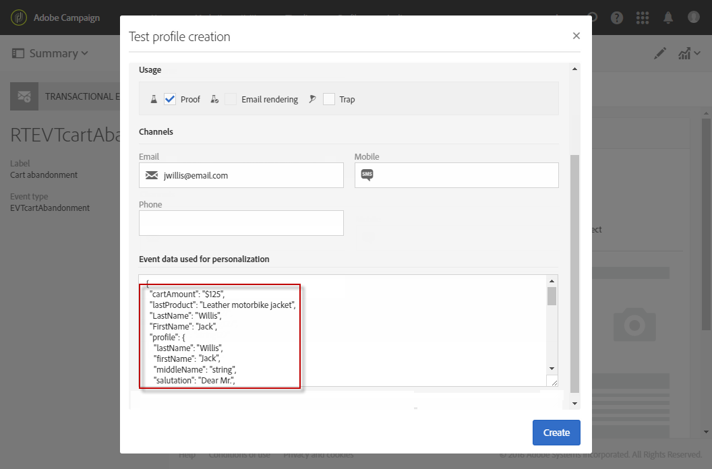
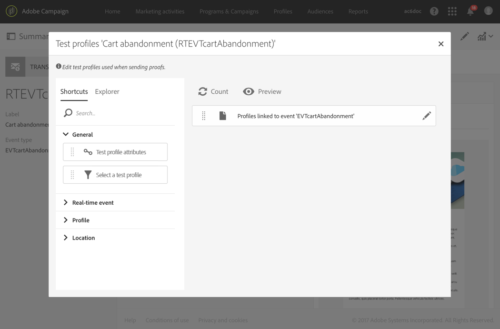
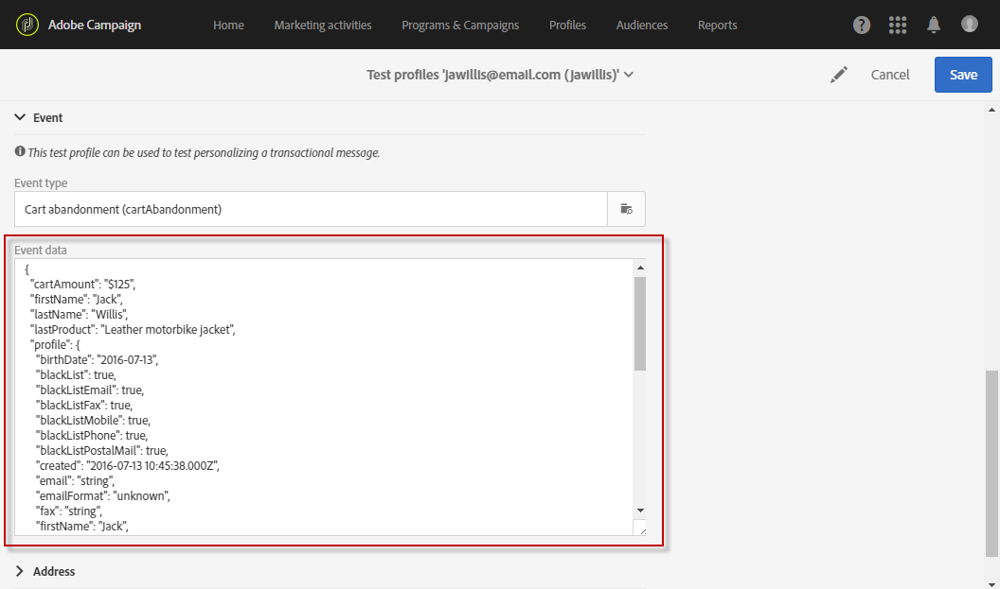
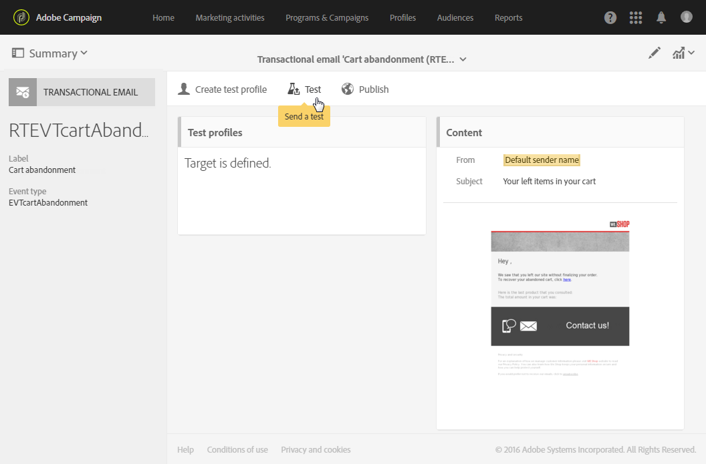

# Teste de mensagem transacional {#testing-a-transactional-message}

Antes de publicar a mensagem transacional, você pode criar um perfil de teste específico que permitirá verificar a mensagem corretamente.

## Definição de um perfil de teste específico {#defining-specific-test-profile}

Defina um perfil de teste que será vinculado ao evento, o que permitirá pré-visualizar a mensagem e enviar uma prova relevante.

1. No [painel de mensagens transacionais](../../channels/using/editing-transactional-message.md#accessing-transactional-messages), clique no botão **[!UICONTROL Create test profile]**.

   

1. Especifique as informações para enviar no formato JSON, na seção **[!UICONTROL Event data used for personalization]**. Esse é o conteúdo que será usado ao visualizar a mensagem e quando o perfil de teste receber a prova.

   

   >[!NOTE]
   >
   >Se você enriqueceu sua mensagem, também pode inserir informações relacionadas a outra tabela, como **[!UICONTROL Profile]**. Consulte [Enriquecimento do evento](../../channels/using/configuring-transactional-event.md#enriching-the-transactional-message-content) e [Personalização de uma mensagem transacional](../../channels/using/editing-transactional-message.md#personalizing-a-transactional-message).

1. Depois de criado, o perfil de teste será pré-especificado na mensagem transacional. Clique no bloco **[!UICONTROL Test profiles]** da mensagem para verificar o público-alvo da prova.

   

Você também pode criar um novo perfil de teste ou usar um que já existe no menu **[!UICONTROL Test profiles]**. Para isso:

1. Clique no logotipo **Adobe**, no canto superior esquerdo, e selecione **[!UICONTROL Profiles & audiences]** > **[!UICONTROL Test profiles]**.
1. Na seção **[!UICONTROL Event]**, selecione o evento que acabou de criar. Neste exemplo, selecione &quot;Abandono de carrinho (EVTcartAbandonment)&quot;.
1. Especifique as informações para enviar no formato JSON na caixa de texto **[!UICONTROL Event data]**.

   

1. Salve as alterações.
1. [Acesse a mensagem](../../channels/using/editing-transactional-message.md#accessing-transactional-messages) que você criou e selecione o perfil de teste atualizado.

**Tópicos relacionados:**

* [Gerenciamento de perfis de teste](../../audiences/using/managing-test-profiles.md)
* [Criação de públicos-alvo](../../audiences/using/creating-audiences.md)

## Envio de uma prova {#sending-proof}

Depois de criar um ou mais perfis de teste específicos e salvar a mensagem transacional, você pode enviar uma prova para testá-la.

As etapas para enviar uma prova estão detalhadas na seção [Enviar provas](../../sending/using/sending-proofs.md).
