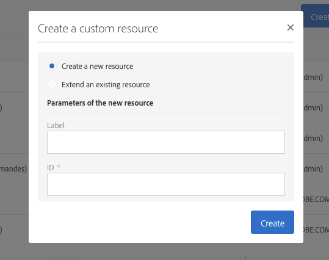
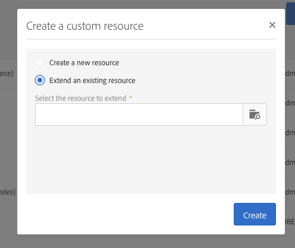

# Criação ou extensão do recurso{#creating-or-extending-the-resource}

Os administradores podem criar um novo recurso do zero ou criar uma extensão de um recurso existente se você precisar trabalhar em dados que não fazem parte do modelo de dados integrado.

Somente os seguintes recursos incorporados podem ser estendidos:

* **[!UICONTROL Campaign (campaign)]**
* **[!UICONTROL Deliveries (delivery)]**
* **[!UICONTROL Landing page (Landingpage)]**
* **[!UICONTROL Profiles (profile)]**
* **[!UICONTROL Program (program)]**
* **[!UICONTROL Service (service)]**
* **[!UICONTROL Subscriptions to an application (appSubscriptionRcp)]**
* **[!UICONTROL Test profiles (seedMember)]**
* **[!UICONTROL Workflow (workflow)]**

Para criar ou estender um recurso:

1. Em **[!UICONTROL Administration]** > **[!UICONTROL Development]** > **[!UICONTROL Custom Resources]**, clique no botão **[!UICONTROL Create]**.
1. Escolha a ação que deseja executar:

   * **[!UICONTROL Create a new resource]**: Insira os campos **[!UICONTROL Label]** e **[!UICONTROL ID]**. O campo **[!UICONTROL ID]** é obrigatório. Se você deixar o campo Label vazio, ele será automaticamente preenchido a partir da ID.

     

     >[!NOTE]
     >
     >Use no máximo 30 caracteres.

   * **[!UICONTROL Extend an existing resource]**: Selecione o recurso que deseja estender.

     

1. Clique em **[!UICONTROL Create]** para criar o recurso, que assumirá o status **[!UICONTROL Draft]** no caso de um novo recurso ou o status **[!UICONTROL Editing]** no caso de uma extensão.

O novo recurso é criado e agora pode ser configurado. Para obter mais informações sobre a configuração de recursos, consulte [Configurando a estrutura de dados do recurso](../../developing/using/configuring-the-resource-s-data-structure.md).
