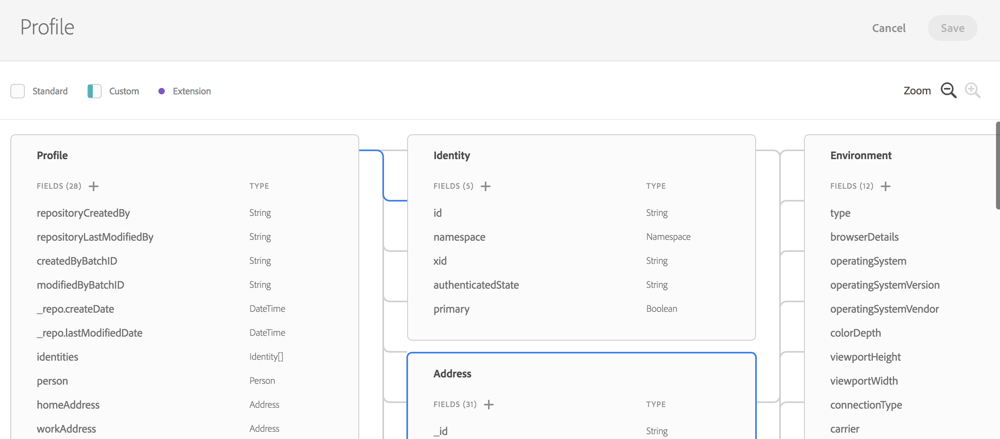

# Visão geral do modelo de dados de experiência {#experience-data-model-overview}

>[!IMPORTANT]
>
>O Conector de dados do Adobe Experience Platform está atualmente na versão beta, que pode estar sujeita a atualizações frequentes sem aviso prévio. Os clientes precisam ser hospedados na Azure (atualmente na versão beta somente para a América do Norte) para acessar esses recursos. Entre em contato com o Atendimento ao cliente da Adobe se desejar obter acesso.

O Experience Data Model (XDM) é um conjunto padrão de esquemas de dados nos quais os dados podem ser assimilados para uso com soluções e produtos da Adobe Experience Platform.

A criação e o gerenciamento de esquemas XDM estão disponíveis com uma API dedicada ou com a interface do usuário XDM.

## Espaço de trabalho XDM {#xdm-workspace}

O XDM Workspace oferece a capacidade de exibir, criar e estender esquemas de dados.

Para acessar a interface do usuário XDM, abra o Adobe Experience Platform. Navegue até a janela Modelo de dados para criar ou estender um esquema XDM.

Consulte a [documentação completa do XDM Workspace](https://experienceleague.adobe.com/docs/experience-platform/xdm/api/getting-started.html?lang=pt-BR).

## API XDM {#xdm-api}

Você pode executar as seguintes ações por meio da API do esquema XDM:

* Exibir uma lista de esquemas existentes
* Exibir um esquema específico Estender um esquema existente
* Adicionar campos a uma extensão
* Criar e atualizar um novo esquema
* Exibir descritores de esquema
* Criar, atualizar e excluir descritores de esquema

Todos os detalhes para manipular chamadas de API estão disponíveis no [Guia do Desenvolvedor](https://experienceleague.adobe.com/docs/experience-platform/xdm/api/getting-started.html?lang=pt-BR).
