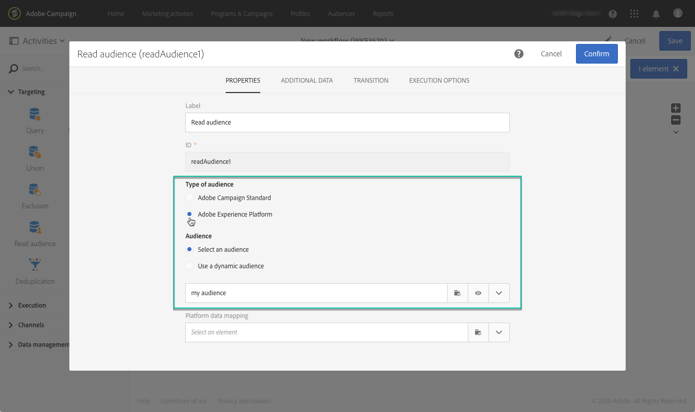
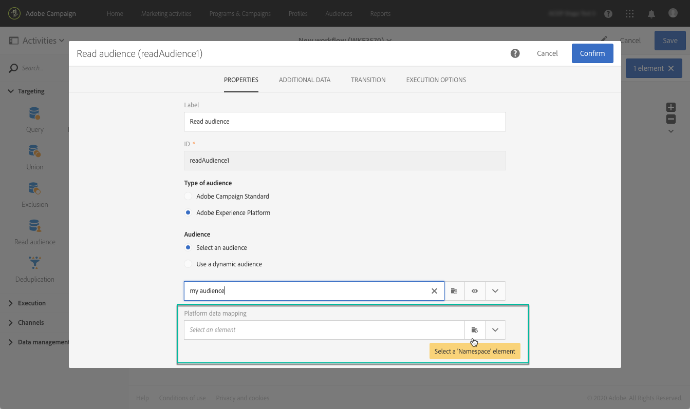
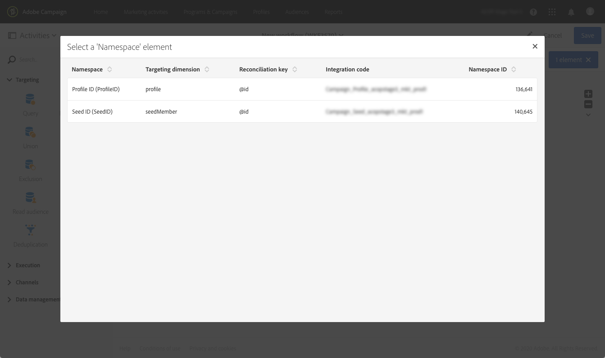
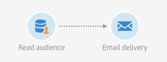

# Direcionamento de públicos-alvos da Adobe Experience Platform {#targeting-aep-audiences}

>[!IMPORTANT]
>
>O serviço Audience Destinations está atualmente em versão beta, que pode estar sujeita a atualizações frequentes sem aviso prévio. Os clientes precisam ser hospedados na Azure (atualmente na versão beta somente para a América do Norte) para acessar esses recursos. Entre em contato com o Atendimento ao cliente da Adobe se desejar obter acesso.

Depois de criar um [público-alvo do Adobe Experience Platform](../../integrating/using/aep-about-audience-destinations-service.md) usando o Construtor de segmentos, você pode usá-lo da mesma forma que faria para um público do Campaign nos fluxos de trabalho para personalizar e enviar mensagens.

Para ativar um público-alvo do Adobe Experience Platform em seus workflows, siga estas etapas:

1. Adicione uma atividade **[!UICONTROL Read audience]** ao fluxo de trabalho e depois a abra.

1. Selecione a opção **[!UICONTROL Adobe Experience Platform]** em **[!UICONTROL Type of audience]** e adicione o público-alvo desejado.

   

1. (Opcional) Depois que o público-alvo é selecionado, você pode clicar no botão do olho para revisar e/ou editar a definição do segmento (salve as alterações novamente).

   Clicar no botão de olho simplesmente direcionará você para o Construtor de segmentos (em outra guia) associado ao público-alvo selecionado no Campaign.

1. Selecione um elemento **[!UICONTROL Platform data mapping]** para especificar o targeting dimension desejado para o público-alvo do Adobe Experience Platform selecionado.

   Por padrão, a chave primária (por exemplo, iRecipientID para a tabela de Perfil, iAppSubscriptionID para a tabela AppSubscription ) usada para reconciliação estará automaticamente disponível na lista suspensa. Para direcionar fora da chave primária, você deve criar um **Namespace** personalizado.

   >[!NOTE]
   >
   >Para destinos fora da chave primária, você também deve criar um Target Mapping personalizado que corresponda ao namespace personalizado. Para obter mais informações sobre Target Mapping, consulte [esta seção](../../administration/using/target-mappings-in-campaign.md).

   

   Essa lista contém todos os mapeamentos do Experience Data Model (XDM) que foram configurados na sua instância. Para obter mais informações sobre o Conector de dados do Adobe Experience Platform, consulte [este documento dedicado](../../integrating/using/aep-about-data-connector.md).

   

1. Depois que as dimensões de público-alvo e direcionamento forem configuradas corretamente, clique no botão **[!UICONTROL Confirm]** para salvar suas alterações.

Agora você pode configurar o fluxo de trabalho com outras atividades. Você pode, por exemplo, vincular uma atividade **[!UICONTROL Email delivery]** para enviar um email ao público selecionado.

>[!NOTE]
>
>O Campaign Standard permite direcionar públicos-alvo da Adobe Experience Platform em todos os canais de entrega: emails, mensagens SMS, mensagens de correspondência direta, notificações por push e mensagens no aplicativo.
>
>*Observação: para todas as mensagens por push e no aplicativo, o Campaign Standard oferece suporte somente a entregas para perfis conhecidos.

Para obter mais informações sobre como usar workflows e deliveries, consulte estas seções:

* [Descobrir fluxos de trabalho](../../automating/using/get-started-workflows.md)
* [Criação de um fluxo de trabalho](../../automating/using/building-a-workflow.md)
* [Descobrir canais de comunicação](../../channels/using/get-started-communication-channels.md)
* [Sobre as atividades de canal](../../automating/using/about-channel-activities.md)
