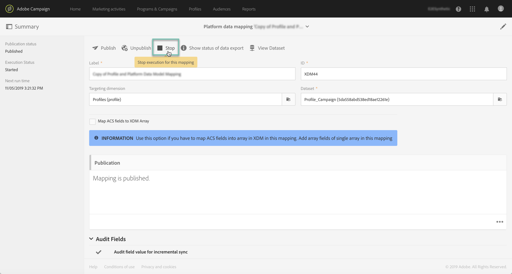

# Acionamento da ingestão de dados por meio de APIs {#triggering-data-ingestion-apis}

>[!IMPORTANT]
>
>O Conector de dados do Adobe Experience Platform está atualmente na versão beta, que pode estar sujeita a atualizações frequentes sem aviso prévio. Os clientes precisam ser hospedados na Azure (atualmente na versão beta somente para a América do Norte) para acessar esses recursos. Entre em contato com o Atendimento ao cliente da Adobe se desejar obter acesso.

O Adobe Campaign Standard permite acionar a assimilação imediata de mapeamentos de dados por meio de APIs e recuperar o status das solicitações de assimilação.

Esta página descreve como acionar e recuperar o status de assimilação dos mapeamentos de dados. Para obter informações globais sobre APIs do Campaign Standard, consulte [esta seção](../../api/using/get-started-apis.md).

## Pré-requisitos {#prerequisites}

Antes de usar as APIs, o mapeamento de dados deve ter sido configurado e publicado na interface do Campaign Standard. Para saber mais, consulte estas seções:

* [Definição de mapeamento](../../integrating/using/aep-mapping-definition.md)
* [Ativação de mapeamento](../../integrating/using/aep-mapping-activation.md)

Depois que o mapeamento de dados for criado, você deverá impedir a execução para que possa acioná-lo a partir das APIs sempre que desejar. Para fazer isso, siga estes passos:

1. No Campaign Standard, vá para o menu **[!UICONTROL Administration]** > **[!UICONTROL Development]** > **[!UICONTROL Platform]** > **[!UICONTROL Status of data export to platform]**.

1. Clique duas vezes no mapeamento de dados para abri-lo e clique no botão **[!UICONTROL Stop]**.

   

1. Salve as alterações

A execução do mapeamento de dados foi interrompida. Você pode usar APIs do Campaign Standard para acioná-lo manualmente.

## Iniciar a assimilação imediata do mapeamento de dados {#starting-immediate-ingestion}

A assimilação imediata de um mapeamento XDM no Adobe Experience Platform é acionada com uma operação POST:

`POST https://mc.adobe.io/<ORGANIZATION>/campaign/dataIngestion/xdmIngestion/<XDM Mapping ID>/ingest`

>[!NOTE]
>
>Para executar a chamada da API POST de assimilação, o usuário deve ter uma função **execução da função SQL**, que pode ser fornecida por um administrador do Campaign Standard executando o script JS abaixo:
>
>```
>var sqlRoleObj = REST.head.roleBase.sql.get();
>REST.head.securityGroup.Administrators.roles.post(sqlRoleObj);
>```
>

A operação POST retorna informações sobre o status da solicitação criada:

* Solicitação enviada com sucesso para o Mapeamento XDM:

```
{
"requestId": <value>,
"info": "Ingestion request submitted successfully for the Mapping ID: <value>",
"status":"Success"
}
```

* Solicitação já em andamento para o Mapeamento XDM:

```
{
"requestId": <value>,
"info": "Ingestion request already in progress for the Mapping ID: <value>",
"status":"In Progress"
}
```

* A solicitação falhou porque o mapeamento XDM não foi publicado ou foi interrompido:

```
{
"info": "Unable to submit data ingestion request, XDM Mapping ID: <value> is not stopped",
"status": "Failed"
}
{
"info": "Unable to submit data ingestion request, XDM Mapping ID: <value> is not published",
"status": "Failed"
}
```

## Recuperando o status de uma solicitação de assimilação {#retrieving-status}

O status de uma solicitação de assimilação pode ser recuperado com uma operação GET e a ID de solicitação desejada nos parâmetros:

```
GET https://mc.adobe.io/<ORGANIZATION>/campaign/dataIngestion/xdmIngestion/<XDM Mapping ID>/ingest
{"requestId"="<value>"}
```

>[!NOTE]
>
>Informações detalhadas sobre o status da solicitação de mapeamento XDM e seus trabalhos relacionados estão disponíveis na interface do Campaign Standard, no menu **[!UICONTROL Status of data export to platform]** (consulte [Ativação de mapeamento](../../integrating/using/aep-mapping-activation.md)).

A operação GET retorna as informações abaixo:

* **batchId**: este campo é preenchido somente se ocorrer uma falha após a preparação do lote e o carregamento,
* **info**: a ID do mapeamento XDM,
* **numRecords**: o número de registros que foram assimilados (somente status de sucesso),
* **status**: o status de solicitação de assimilação (sucesso/falha/em andamento)

As respostas possíveis para a operação GET são:

* Solicitação de assimilação bem-sucedida:

  ```
  {
  "batchId": "",
  "info": "Mapping Id: <value>. ",
  "numRecords": 15,
  "requestId": 3520,
  "status": "Success"
  }
  ```

* A solicitação de assimilação falhou com 0 registro assimilado:

  ```
  {
  "batchId": "",
  "info": "Mapping Id: <value>. ACP-880056 Failed to fetch the record from the database.",
  "numRecords": 0,
  "requestId": 3520,
  "status": "Failed"
  }
  ```

* A solicitação de assimilação falhou, com alguns registros carregados em um lote:

  ```
  {
  "batchId": "<value>",
  "info": "Mapping Id: <value>. ACP-880096 Sync Job failed to upload. Please check the error in the Platform UI.",
  "numRecords": 0,
  "requestId": <value>,
  "status": "Failed"
  }
  ```

* Solicitação de assimilação anulada após assimilar alguns registros (isso pode acontecer em cenários de falha):

  ```
  {
  "batchId": "",
  "info": "Mapping Id: <value>. Ingestion request aborted due to some issue with data ingestion service. Please submit a new request",
  "numRecords": 0,
  "requestId": <value>,
  "status": "Aborted"
  }
  ```

* Solicitação de assimilação em andamento (quando a solicitação carregou os dados em um lote ou quando o lote está sendo preparado para a solicitação):

  ```
  {
  "batchId": "",
  "info": "Mapping Id: <value>.",
  "numRecords": 0,
  "requestId": <value>,
  "status": "In Progress"
  }
  ```
