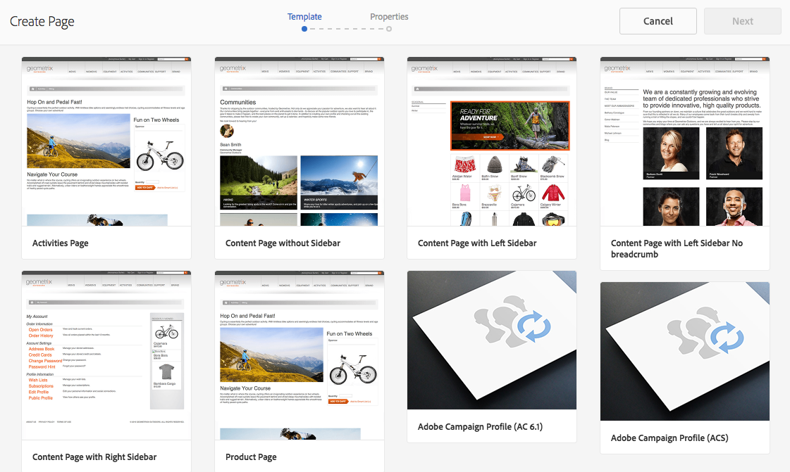
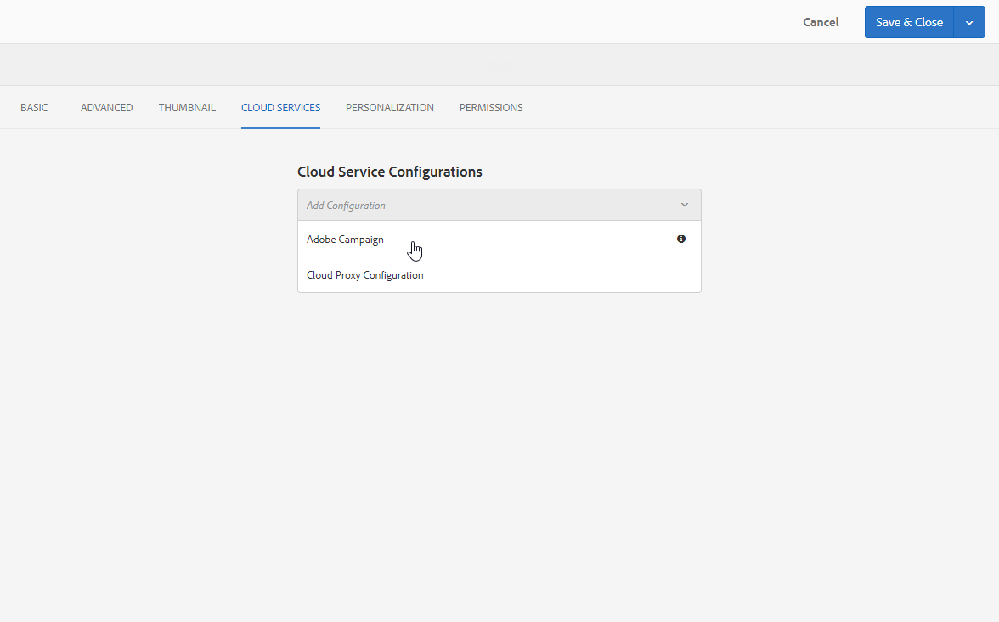

# Criação de um formulário do Campaign no Experience Manager {#creating-a-campaign-form-in-experience-manager}

Você pode criar &quot;formulários&quot; nos sites do AEM e mapear os campos em um formulário para os campos no banco de dados do Adobe Campaign. Isso permite criar e atualizar perfis ou gerenciar as assinaturas de um serviço.

Para criar um formulário do Adobe Campaign no seu site do AEM:

1. No site do AEM, crie uma nova página com base no modelo **Perfil do Adobe Campaign**.

   

1. Nas propriedades da página, selecione o **[!UICONTROL Cloud Service]** correspondente à sua instância do Adobe Campaign.

   

1. Selecione o tipo de formulário do componente **[!UICONTROL Form Start]**:

   * **Adobe Campaign: Salvar perfil**
   * **Adobe Campaign: Assinar Serviços**
   * **Adobe Campaign: cancelar assinatura dos serviços**

1. Edite o conteúdo do formulário adicionando diferentes campos e componentes que você pode mapear para os campos do banco de dados do Adobe Campaign.
1. Teste e publique o formulário para torná-lo acessível no site do AEM.

Para obter mais informações, consulte a [documentação detalhada](https://experienceleague.adobe.com/docs/experience-manager-65/authoring/aem-adobe-campaign/adobe-campaign-forms.html?lang=pt-BR).
