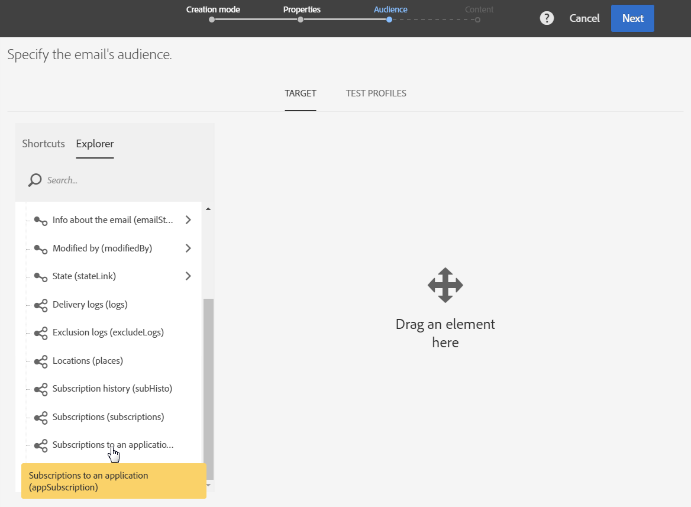
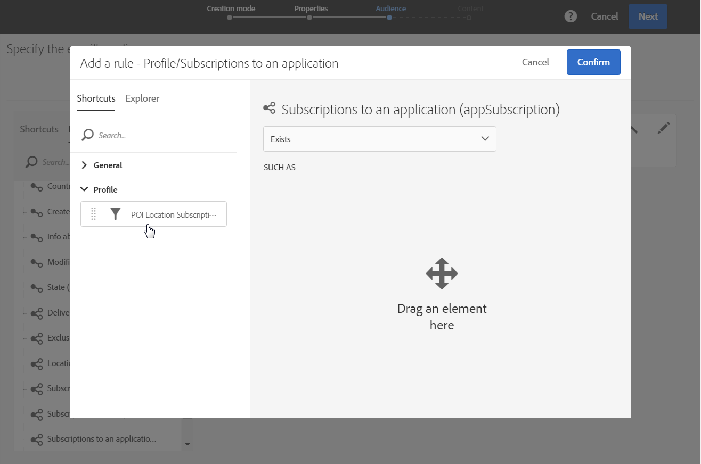
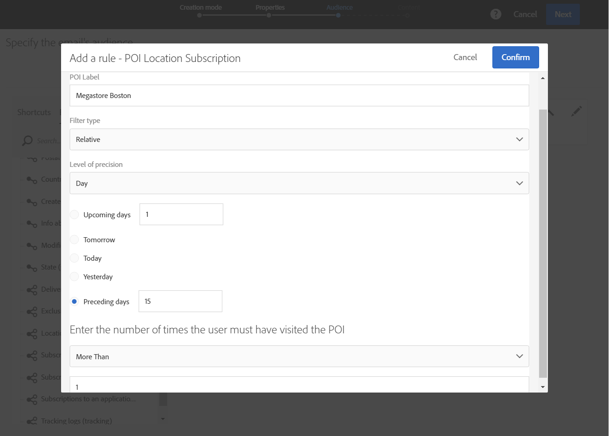
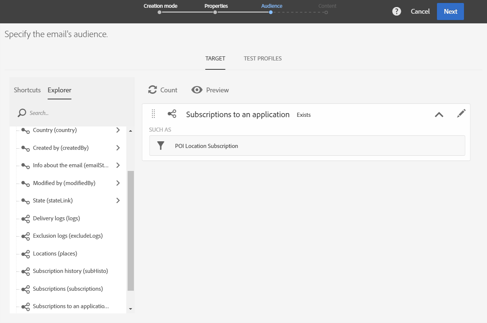
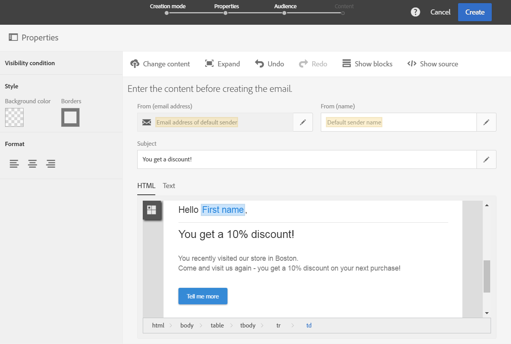

# Personalização de mensagens do Campaign com dados de Ponto de interesse{#personalizing-campaign-messages-with-point-of-interest-data}

No Adobe Campaign, você pode usar os dados de Pontos de interesse coletados dos assinantes do aplicativo móvel para enviar a eles mensagens de marketing personalizadas, como um email.

Você só pode reagir em dados de Ponto de interesse com deliveries padrão. [As mensagens transacionais](../../channels/using/getting-started-with-transactional-msg.md) não podem usar os dados de localização.

O mais cedo que você pode reagir é em torno de 10 minutos.

Nesse caso, você decide enviar um email para todos os assinantes que visitaram sua loja em Boston nas últimas duas semanas.

1. Crie uma atividade de marketing por email.
1. Ao definir o público-alvo da entrega, arraste e solte o elemento **[!UICONTROL Subscriptions to an application]** no espaço de trabalho.

   

   O gerenciamento de públicos está detalhado na seção [Definição de públicos](../../audiences/using/creating-audiences.md).

1. Na janela **[!UICONTROL Add a rule - Profile/Subscriptions to an application]**, arraste e solte o elemento **[!UICONTROL POI Location Subscription]** no espaço de trabalho.

   

1. Na janela **[!UICONTROL Add a rule - POI Location Subscription]**, insira o rótulo do Ponto de interesse que você deseja usar.

   

1. No campo **[!UICONTROL Filter type]**, selecione **[!UICONTROL Relative]**.
1. Marque a opção **[!UICONTROL Preceding days]** e insira **[!UICONTROL 15]** no campo correspondente.
1. Defina o número de vezes que o usuário deve ter visitado o Ponto de interesse.
1. Clique em **[!UICONTROL Confirm]** para salvar seu público-alvo.

   

1. Adicione conteúdo ao email.

   

1. Confirme a criação da atividade para visualizar o painel do email.
1. Envie sua mensagem.

O email com a oferta de desconto de 10% será enviado aos assinantes que:

* Visitou sua loja de Boston pelo menos uma vez nas últimas duas semanas.
* Seu aplicativo móvel ficou em primeiro plano pelo menos uma vez durante a visita.

**Tópicos relacionados:**

* [Criação de um email](../../channels/using/creating-an-email.md)
* [Definição do conteúdo](../../designing/using/personalization.md#example-email-personalization)
* [Envio de mensagens](../../sending/using/confirming-the-send.md)
