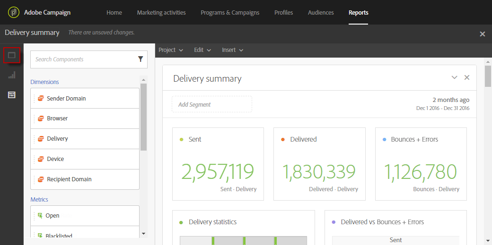
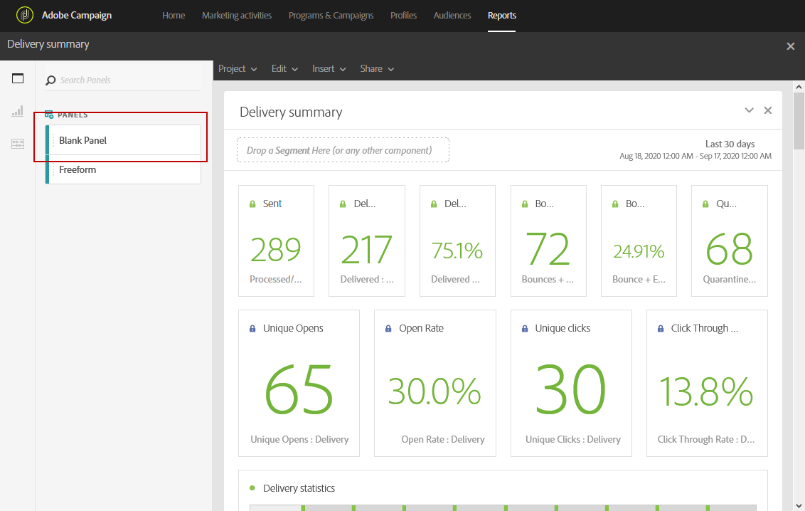
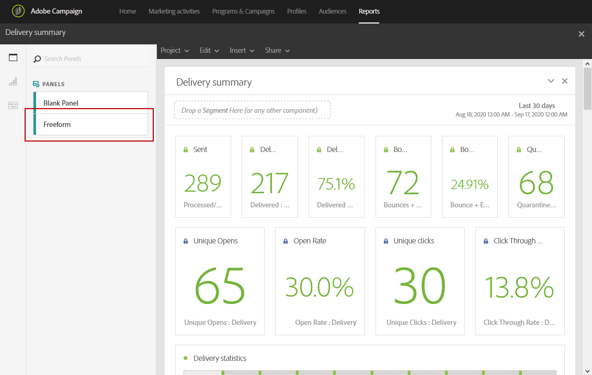
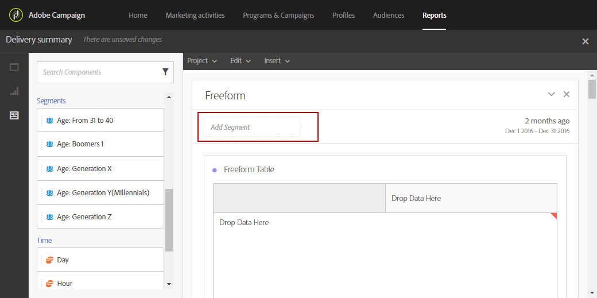
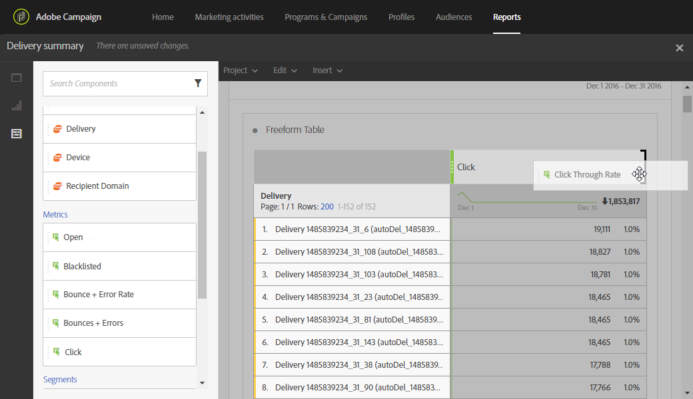
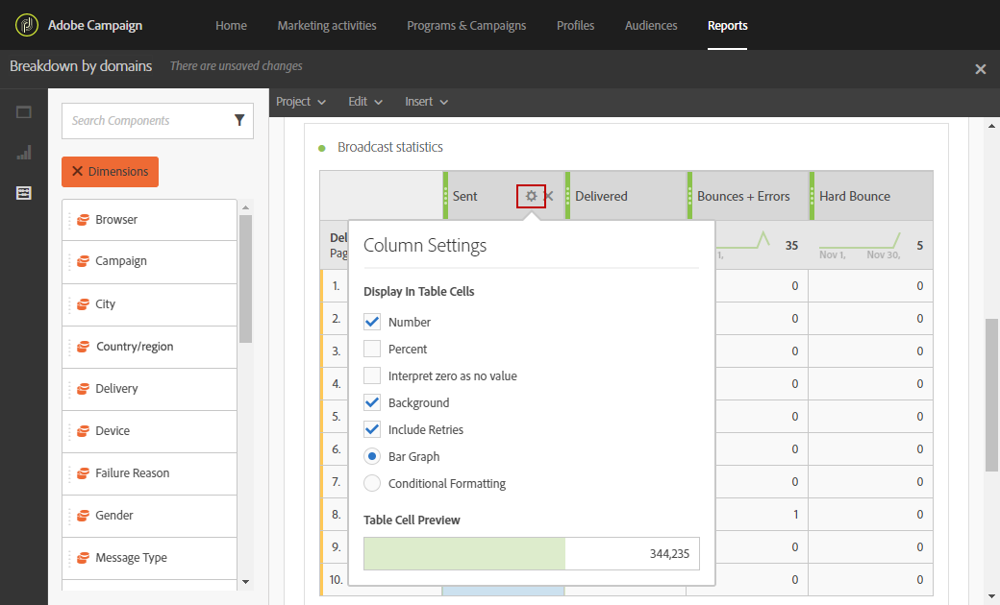
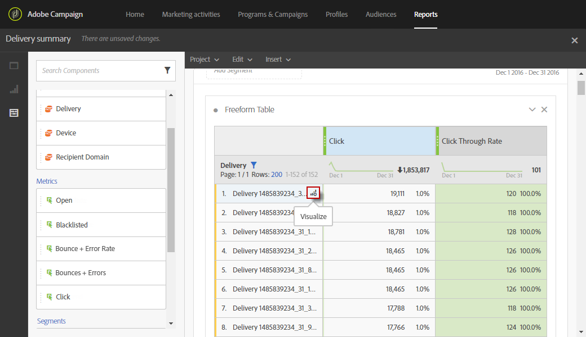

# Adicionar painéis{#adding-panels}

## Adição de um painel em branco {#adding-a-blank-panel}

Para iniciar seu relatório, você pode adicionar um conjunto de painéis a um relatório pronto para uso ou personalizado. Cada painel contém diferentes conjuntos de dados e é composto por tabelas e visualizações de forma livre.

Esse painel permite criar relatórios conforme necessário. Você pode adicionar quantos painéis desejar em seus relatórios para filtrar seus dados com diferentes períodos de tempo.

1. Clique no ícone **Painéis**. Você também pode adicionar um painel clicando na **guia Inserir** e selecionando **Novo Painel em Branco**.

   

1. Arraste e solte o **Painel em Branco** no painel.

   

Agora é possível adicionar uma tabela de forma livre ao painel para começar a direcionar dados.

## Adição de uma tabela de forma livre {#adding-a-freeform-table}

As tabelas de forma livre permitem criar uma tabela para analisar seus dados usando as diferentes métricas e dimensões disponíveis na tabela **Componente**.

Cada tabela e visualização é redimensionável e pode ser movida para personalizar melhor seu relatório.

1. Clique no ícone **[!UICONTROL Panels]**.

   

1. Arraste e solte o item **[!UICONTROL Freeform]** no seu painel.

   Você também pode adicionar uma tabela clicando na guia **[!UICONTROL Insert]** e selecionando **[!UICONTROL New Freeform]** ou clicando em **[!UICONTROL Add a freeform table]** em um painel vazio.

   

1. No campo **[!UICONTROL Drop a segment here]**, adicione um **[!UICONTROL Segment]** da guia **[!UICONTROL Components]** na barra superior.

   

1. Arraste e solte itens da guia **[!UICONTROL Components]** nas colunas e linhas para criar sua tabela.

   

1. Clique no ícone **[!UICONTROL Settings]** para alterar como os dados são exibidos em suas colunas.

   

   O **[!UICONTROL Column settings]** é composto de:

   * **[!UICONTROL Number]**: permite mostrar ou ocultar números de resumo na coluna.
   * **[!UICONTROL Percent]**: permite mostrar ou ocultar a porcentagem na coluna.
   * **[!UICONTROL Interpret zero as no value]**: permite mostrar ou ocultar quando o valor é igual a zero.
   * **[!UICONTROL Background]**: permite mostrar ou ocultar a barra de progresso horizontal nas células.
   * **[!UICONTROL Include retries]**: permite incluir tentativas no resultado. Isto só está disponível para **[!UICONTROL Sent]** e **[!UICONTROL Bounces + Errors]**.

1. Selecione uma ou várias linhas e clique no ícone **[!UICONTROL Visualize]**. Uma visualização é adicionada para refletir as linhas selecionadas.

   

Agora é possível adicionar quantos componentes forem necessários e também adicionar visualizações para fornecer representações gráficas de seus dados.
