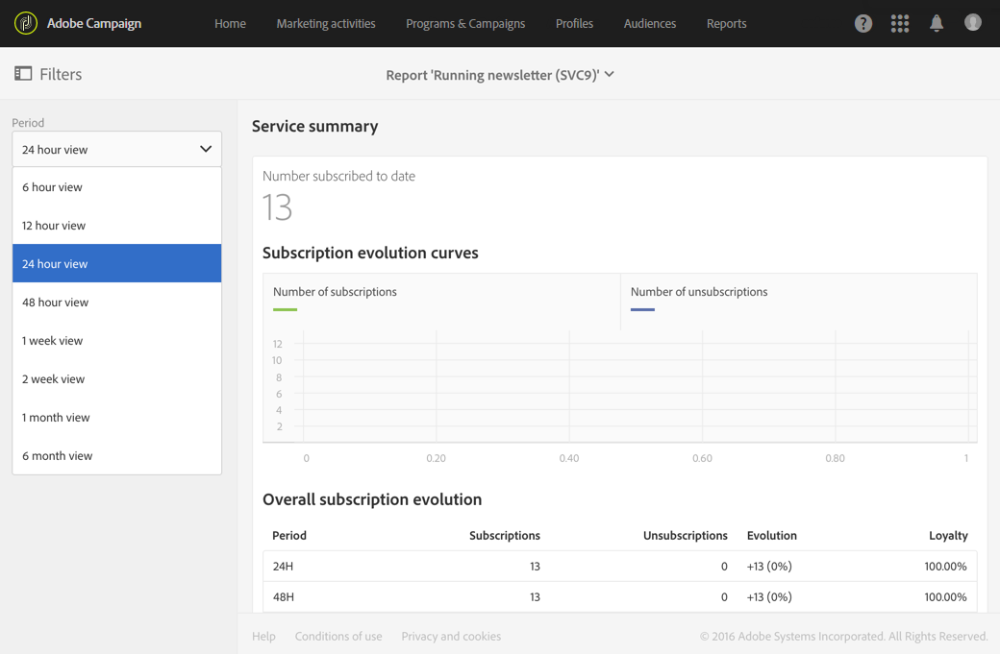

# Resumo do serviço{#service-summary}

O **[!UICONTROL Service summary]** detalha a evolução das assinaturas e dos cancelamentos de assinaturas do seu serviço.
Este relatório só pode ser acessado na página Serviço por meio do menu avançado **[!UICONTROL Profiles & Audiences]** > **[!UICONTROL Services]**. Para obter mais informações, consulte esta [página](../../audiences/using/monitoring-subscriptions.md#service-reports).

A visualização **[!UICONTROL Subscription evolution curves]** detalha o número de assinaturas e cancelamentos de assinaturas dependendo da **[!UICONTROL Period]** escolhida na barra suspensa.

O **[!UICONTROL Overall subscription evolution]** permite ver a evolução dos assinantes em diferentes períodos.
